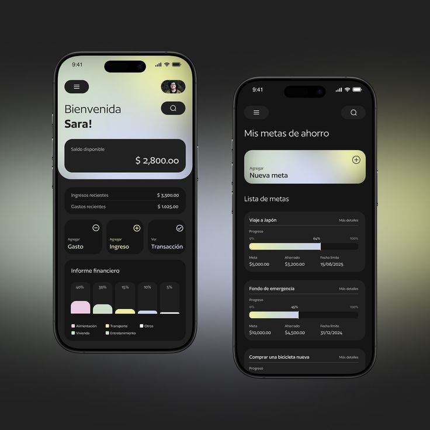

# Dark Budget App with Pastel Gradient Header

**Discipline:** app · **Design type:** Fintech app screens
**Tags:** budget, dark, pastel-gradient, goals, bars, spanish, two-phones

## What it is
Two dark phones on a grey gradient: a home with a pastel yellow-lilac gradient header, a black balance card, add expense, income and view transaction tiles and a bar chart of categories; and a savings goals screen with gradient progress bars.

## What it means
A soft pastel gradient header lifts an otherwise dark app, and the same gradient fills the progress bars for unity.

## Techniques
- Pastel gradient as the header and progress fill
- Black cards for key figures
- Rounded action tiles with icons
- Category bars in pastel colours
- Two phones side by side at different heights

## Best for
- Budgeting and savings apps
- Dark UI with a gradient accent
- Localised fintech mockups

## Vocabulary
- **Gradient header** — A top area filled with a colour blend.
- **Goal bar** — A progress bar for a savings target.
- **Action tile** — A tile with an icon and label for a quick action.
