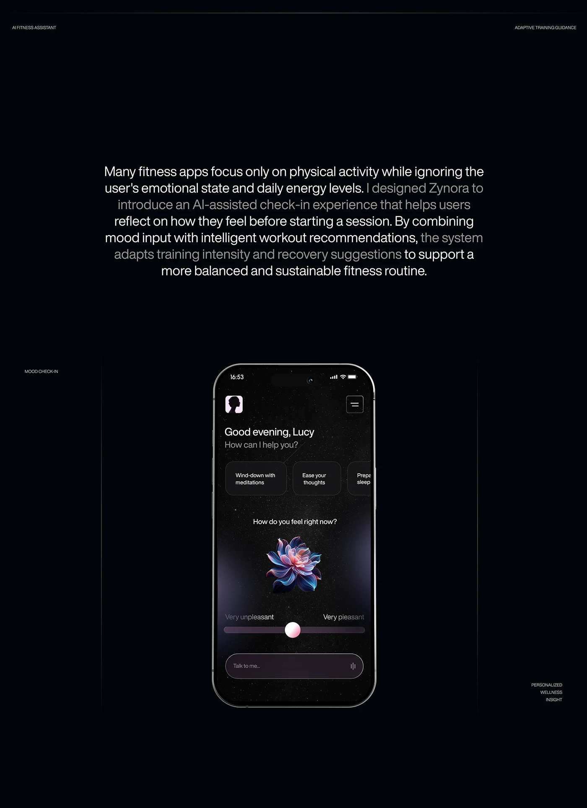

# Starfield AI check-in with a glowing flower, slider and long dimmed-and-bright case-study text

**Discipline:** app ·  · **Design style:** Gradient & Aurora
**Tags:** ai, mood, dark, starfield, flower, slider, case-study, emphasis-text

## What it is
A black case-study page with tiny caps labels, a big paragraph where sentences alternate white and grey, and a phone with a starry background, greeting, chips, a glowing iridescent flower above 'How do you feel right now?', a pastel slider and a 'Talk to me' voice field.

## What it means
Meditative and intimate; the flower stands in for emotion.

## Techniques
- Use a glowing organic object as an emotion indicator.
- Alternate bright and dim sentences.
- Keep the phone small in a vast black page.
- Use a single slider for mood.

## Best for
- Wellbeing and AI companion apps
- Dark, calm case studies
- Mood input patterns

## Vocabulary
- **Emotion object** — A symbolic visual reflecting the user's state.
- **Bright-dim text** — Alternating text brightness to guide reading.
- **Mood slider** — A slider from unpleasant to pleasant.
- **Voice field** — A prompt bar with a mic icon.
