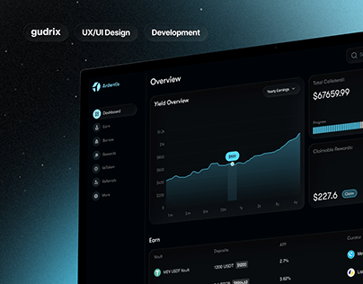

# Dark DeFi dashboard on a teal-glow starfield

**Discipline:** app · **Design type:** Dark dashboard
**Tags:** dashboard, dark-mode, crypto, area-chart, teal-glow, case-study-cover, tilted-mockup

## What it is
A project cover: black starfield with a teal glow at the right, the studio name and discipline chips at top left, and a tilted desktop dashboard with sidebar, an area chart, collateral totals and an earn table.

## What it means
Technical, premium and futuristic; the glow suggests energy and live data.

## Techniques
- Tilt the dashboard in perspective so it feels like a 3D object in space.
- Use one cool glow (teal) to light the UI from one side.
- Limit the chart palette to one line colour with a gradient fill.
- Put small outlined chips at the top for context instead of a big heading.
- Keep panels near-black with hairline borders for layered depth.

## Best for
- Crypto, trading and analytics product covers
- Dark-themed SaaS showcases
- Portfolio thumbnails for UI projects

## Vocabulary
- **Area chart** — A line chart with the area under it filled.
- **Glow gradient** — A soft light bloom in an accent colour behind or beside an object.
- **Case-study cover** — The first image of a portfolio project.
- **Chip** — A small rounded tag with a short label.
