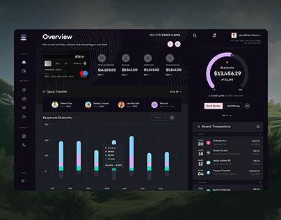

# Dark banking dashboard floating over a soft-focus green hillside with a lilac donut and stacked capsule bars

**Discipline:** app · **Design type:** Dashboard
**Tags:** dashboard, dark, finance, lilac, donut, capsule-bars, hills, card

## What it is
A dark desktop dashboard with a left icon rail, an Overview heading, a bank card and four stat columns, a Quick Transfer row of avatars, an expenses chart of capsule-shaped bars in blue, lilac and mint, and a right column with a lilac donut with $13,456.29 and a recent transactions list, over a blurred green landscape photo.

## What it means
Calm and premium; dark glass panels over a natural photo soften data.

## Techniques
- Float a dark dashboard over a landscape photo.
- Draw bars as stacked capsules.
- Use a lilac donut for the balance.
- Keep a slim icon rail.

## Best for
- Finance dashboards
- Dark UI showcases
- Photo-backdrop presentations

## Vocabulary
- **Capsule bar** — A bar with fully rounded ends.
- **Stacked segment** — A bar built from coloured parts.
- **Photo backdrop** — A blurred photo behind a UI.
- **Icon rail** — A narrow vertical strip of icons.
