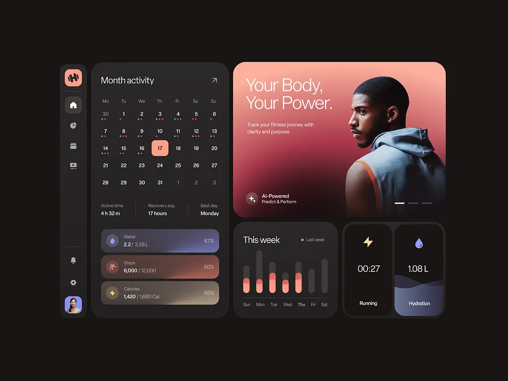

# Dark bento fitness dashboard: month calendar, coral portrait hero, gradient progress bars and small widgets

**Discipline:** app · **Design type:** Dashboard
**Tags:** dashboard, fitness, dark, coral, bento, calendar, gradient-bars, widgets

## What it is
A charcoal bento dashboard with a left icon rail, a month activity calendar with coral selected date and dots, three progress bars with tinted gradients (water, steps, calories), a large coral-to-maroon hero card with a portrait and 'Your Body, Your Power.', a weekly bar chart and two widgets for timer and hydration.

## What it means
Warm and powerful; coral on charcoal feels energetic yet calm.

## Techniques
- Build a bento of rounded dark cards.
- Use coral as the single accent.
- Give progress bars a soft gradient.
- Add a large photographic hero card.

## Best for
- Fitness and health dashboards
- Dark bento layouts
- Coral accent systems

## Vocabulary
- **Bento dashboard** — A dashboard of varied rounded tiles.
- **Selected date** — A highlighted day in a calendar.
- **Gradient progress bar** — A bar with a tinted gradient fill.
- **Hero card** — A large photo card at the top.
