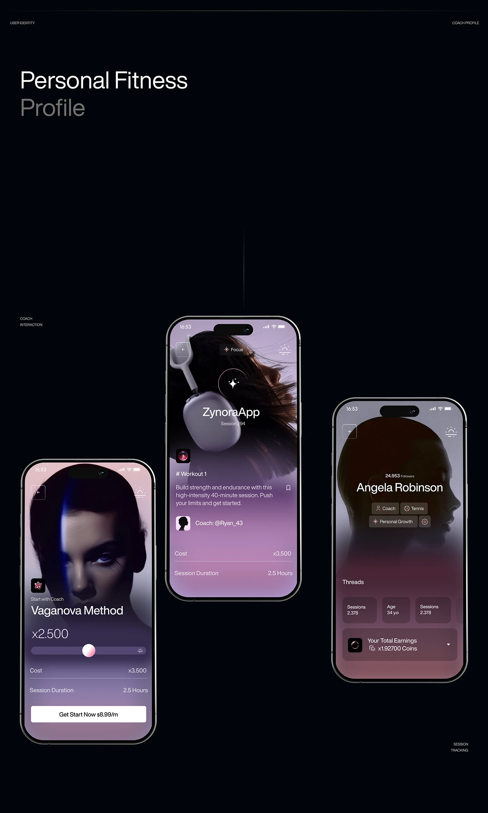

# Fitness profiles with moody purple-blur portraits and grey glass rows

**Discipline:** app · **Design type:** Fitness app screens
**Tags:** fitness, profile, dark, purple-gradient, portrait, glass, silhouette, case-study

## What it is
A black board titled 'Personal Fitness Profile' with three phones. Each screen is a purple-to-mauve gradient over a dramatic portrait (a face in shadow, hair and headphones, a silhouette of a head) with white text, small tag chips and translucent rows for cost, duration and earnings.

## What it means
Intimate and cinematic; the fading portrait makes a fitness app feel like a fashion editorial.

## Techniques
- Let a dark portrait fade into a gradient that carries the UI.
- Set text as white on translucent grey glass rows.
- Use small chips for attributes such as role and sport.
- Anchor with a single white button.
- Give the presentation black staging with tiny corner labels.

## Best for
- Premium fitness and coaching apps
- Profile screens with strong photography
- Dark editorial app showcases

## Vocabulary
- **Portrait fade** — A photo dissolving into a colour gradient.
- **Glass row** — A translucent list row over an image.
- **Attribute chip** — A small label listing a trait.
- **Cinematic UI** — An interface treated like a film still.
