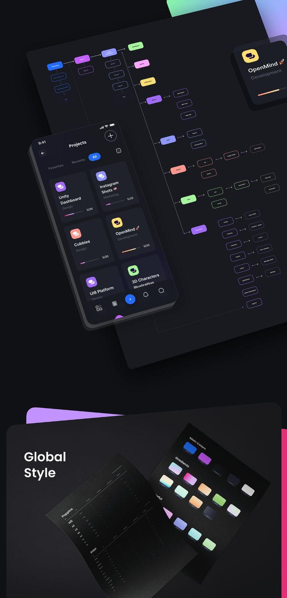

# Dark Flowchart and Global Style Sheets

**Discipline:** app ·  · **Design style:** Gradient & Aurora
**Tags:** flowchart, global-style, dark, gradients, typography, projects, 3d-layers

## What it is
A tall dark board with a tilted user flow chart of coloured nodes, a projects app phone floating over it, an app icon card, and a Global Style section with tilted sheets showing typography specs and a palette of gradient swatches.

## What it means
Layered tilted sheets make documentation feel like objects on a desk, and coloured nodes and gradients bring life to a dark system.

## Techniques
- Tilted paper-like sheets in 3D space
- Coloured pill nodes in a flowchart
- Phone floating above the flow diagram
- Gradient swatches as a palette
- Coloured slabs peeking from behind panels

## Best for
- Design-system and flow overviews
- Dark project boards
- Case studies showing structure and style

## Vocabulary
- **Flowchart node** — A coloured pill representing a screen or step.
- **Global style** — The shared colours, type and gradients of a product.
- **Floating sheet** — A document rendered in 3D floating over a surface.
