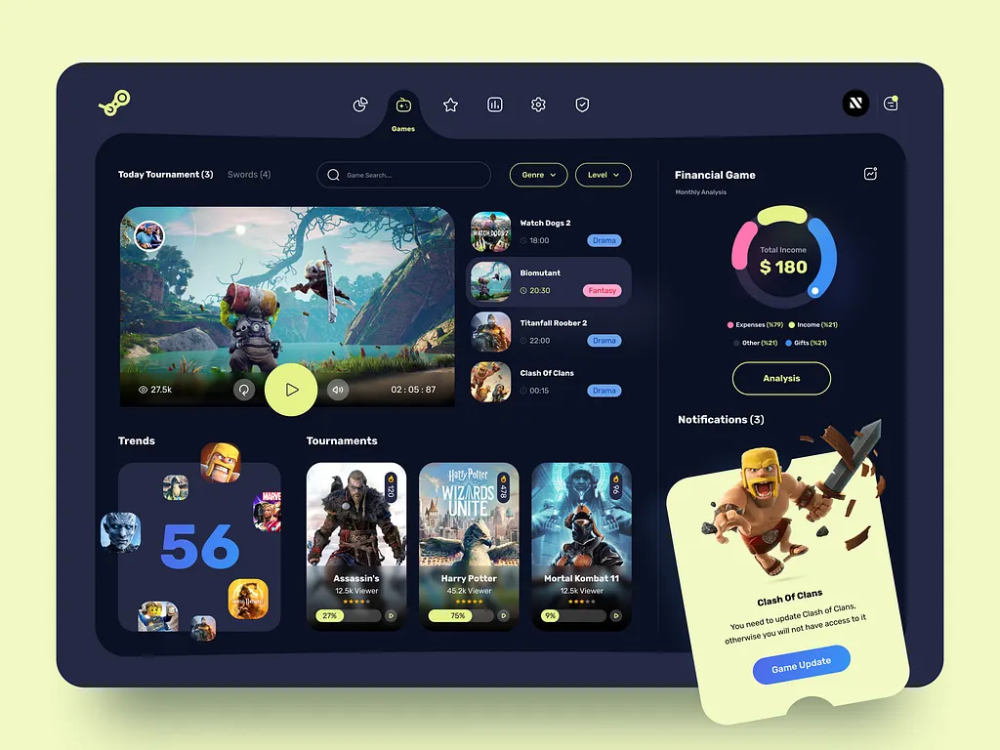

# Navy games dashboard with a notched top nav, video hero, tournament cards, donut income ring and a yellow ticket card with a cartoon warrior

**Discipline:** app · **Design type:** Dashboard
**Tags:** dashboard, gaming, navy, lime, yellow, game-cards, donut, ticket-card

## What it is
A yellow-green backdrop with a rounded navy dashboard where a notch in the top bar holds the active Games icon, a large video card with a lime play button beside a list of upcoming games with genre chips, a Trends box with a big blue 56 surrounded by floating game icons, three tall tournament cards with progress bars, a right column with a donut 'Total Income $180' with pink, yellow and blue segments and a lime outlined Analysis button, and a yellow ticket-shaped notification with a Clash of Clans warrior and a blue Game Update button.

## What it means
Playful and energetic; lime outlines and a torn ticket card add game-like flair.

## Techniques
- Notch a nav bar around the active icon.
- Use lime outlines on dark navy.
- Show a donut chart with rounded colour segments.
- Break out one card as a ticket with cutouts.

## Best for
- Gaming platforms
- Dark playful dashboards
- Ticket-style notifications

## Vocabulary
- **Notched nav** — A nav bar with a cut-out around the active item.
- **Ticket card** — A card with semicircle notches like a ticket.
- **Outline pill** — A capsule with a coloured border.
- **Floating icon cluster** — App icons scattered around a number.
