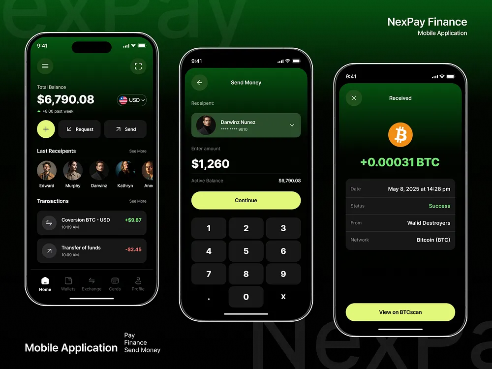

# Dark Green Crypto Finance App Screens

**Discipline:** app ·  · **Design style:** Dark & Neon
**Tags:** crypto, dark-green, lime, keypad, balance, send, received

## What it is
Three phones with white bezels on a black-green field with a ghost brand name: a home with balance, request and send buttons, recent recipients and transactions; a send money screen with recipient, amount and keypad; and a received bitcoin screen with details and a lime button.

## What it means
Dark green gradient screens with lime buttons feel modern and secure, and consistent cards keep the flow calm.

## Techniques
- Dark green gradient header on each screen
- Lime primary buttons
- Dark rounded cards and keypad keys
- Green and red amounts for positive and negative
- Ghost brand name behind the phones

## Best for
- Crypto and wallet apps
- Dark green and lime UI
- Three-screen flow presentations

## Vocabulary
- **Keypad** — A grid of number keys for entering an amount.
- **Recipient row** — A row of recent contacts for quick sending.
- **Ghost brand name** — Oversized faint text behind a scene.
