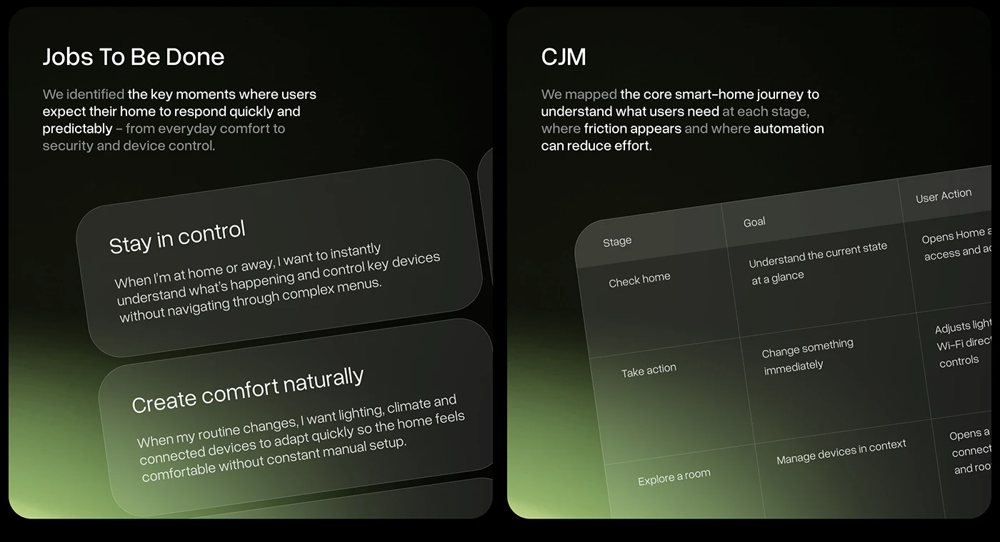

# Glass Jobs-to-Be-Done and Journey Map Panels

**Discipline:** app · **Design type:** UX documentation
**Tags:** jtbd, journey-map, dark, green-glow, glass, tilted, table

## What it is
Two dark rounded panels with a lime-green glow rising from the base: at left a Jobs To Be Done heading with tilted frosted glass cards stating user needs, and at right a CJM heading with a tilted glass table of Stage, Goal and User Action rows, each with a short paragraph with phrases in brighter white.

## What it means
Tilting glass cards and tables in 3D makes text-heavy research feel like an object, and the green glow adds atmosphere to a dark slide.

## Techniques
- Glass cards tilted in perspective
- Green glow rising from the bottom corner
- Bright key phrases inside a grey paragraph
- Table rendered as a floating tilted sheet
- Two equal dark panels side by side

## Best for
- Research and journey documentation
- Dark smart-home case studies
- Text content presented as glass objects

## Vocabulary
- **Jobs to be done** — A framework describing what users want to achieve in a situation.
- **Customer journey map (CJM)** — A table of stages, goals and actions over a user's experience.
- **Tilted glass** — Translucent panels rotated in perspective.
