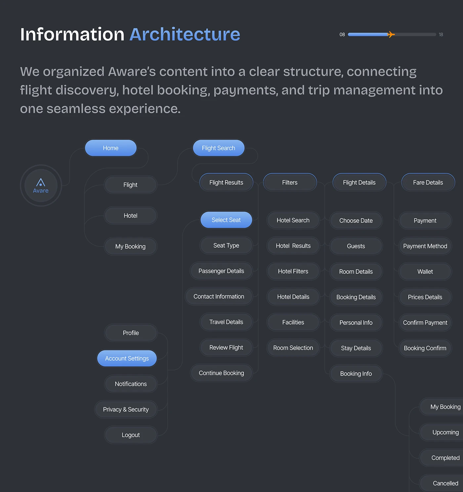

# Dark Information Architecture Pill Tree

**Discipline:** app ·  · **Design style:** Dark & Neon
**Tags:** information-architecture, dark, pills, blue, tree, travel, dense

## What it is
A dark slate slide titled Information Architecture with a plane progress bar, a paragraph and a large dense tree of pill nodes from a logo root through Home, Flight, Hotel and My Booking to detailed steps in columns, with blue gradient pills marking key screens.

## What it means
Dark nodes with a few glowing blue ones make a large structure legible, and the dense grid shows thoroughness.

## Techniques
- Blue gradient pills marking key screens
- Dark grey pills with subtle borders for the rest
- Columns aligned in a grid for a clean tree
- Logo in a circle as the root
- Diagram cropped at the right and bottom

## Best for
- Large sitemaps
- Dark case-study documentation
- Travel and booking apps

## Vocabulary
- **Information architecture** — The organisation and labelling of a product's content.
- **Key node** — A highlighted node marking an important screen.
- **Sitemap tree** — A hierarchical diagram of all screens.
