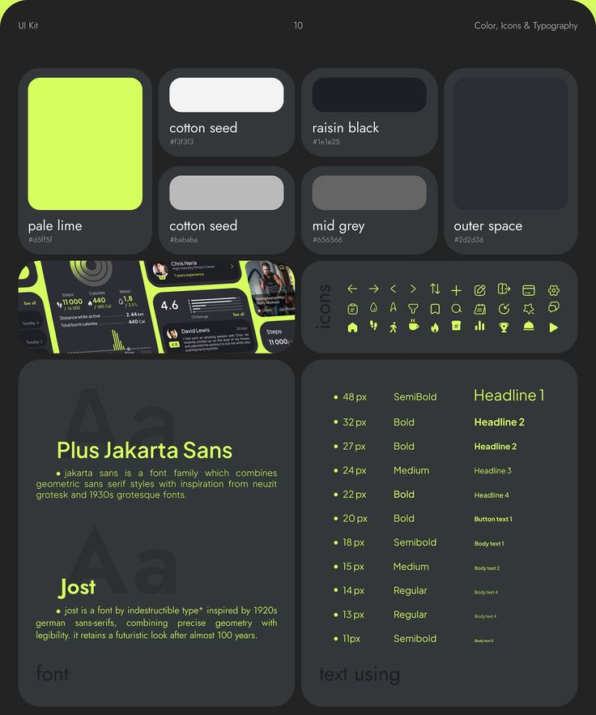

# Dark Lime UI Kit Colour, Icons and Type

**Discipline:** app ·  · **Design style:** Dark & Neon
**Tags:** ui-kit, dark, lime, palette, icons, typography, cards

## What it is
A dark board with rounded panels: colour swatches (pale lime, cotton seed, raisin black, mid grey, outer space), a strip of fitness UI, a grid of lime line icons, font specimens for Plus Jakarta Sans and Jost, and a type scale table.

## What it means
Lime on charcoal is energetic and sporty, and the grid of tiles documents the whole system in one look.

## Techniques
- Swatches as large rounded tiles with names and hex
- Line icon grid in the accent colour
- Type scale table with sizes and sample labels
- Ghost 'Aa' behind the font specimens
- Lime used for all text on dark

## Best for
- Design-system foundations
- Fitness and sports app kits
- Dark-mode documentation

## Vocabulary
- **Foundations board** — A sheet documenting colour, icons and type.
- **Type scale** — A ladder of sizes and weights for each text role.
- **Ghost specimen** — A faint oversized glyph behind text.
