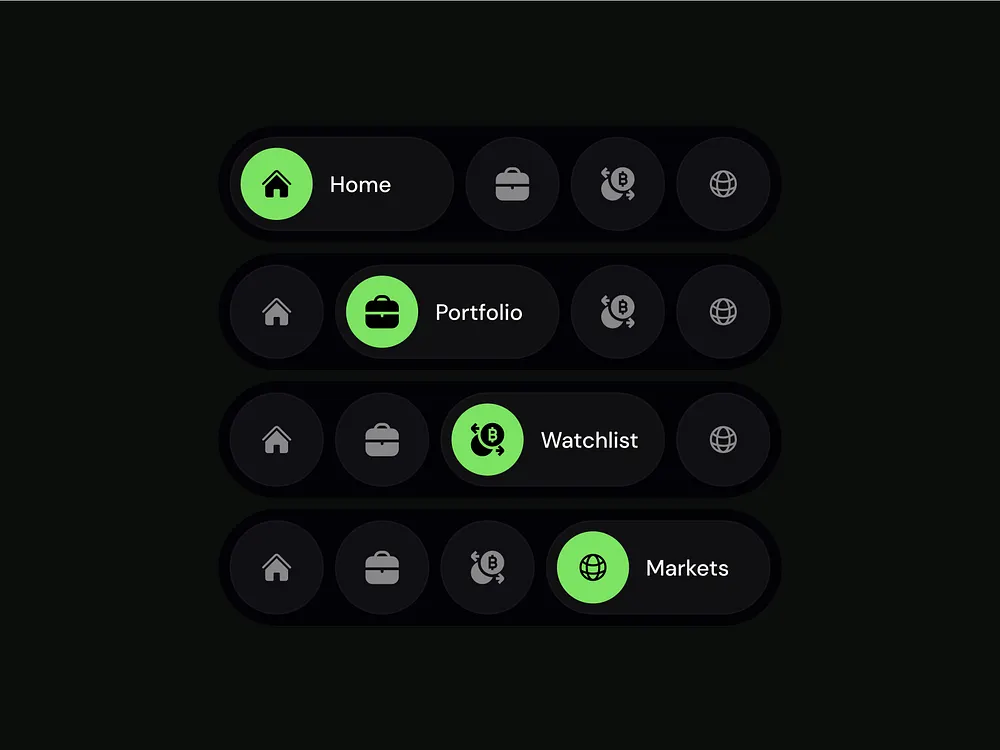

# Expanding Lime Active Nav Pill States

**Discipline:** app · **Design type:** UI components
**Tags:** navigation, dark, lime, expanding, pill, states, finance

## What it is
Four stacked dark navigation bars, each with four circular icon buttons where a different one is active as a lime circle expanded into a pill with a label (Home, Portfolio, Watchlist, Markets), showing the sequence of an animated tab change.

## What it means
Showing each state stacked reveals how the bar behaves, and lime on charcoal is crisp and financial.

## Techniques
- Active item expands into a labelled pill
- Inactive items as grey circles
- Lime and black for the active button
- States stacked vertically to show progression
- Dark on dark background

## Best for
- Navigation interaction documentation
- Finance and crypto apps
- Expanding tab bar patterns

## Vocabulary
- **Expanding tab** — A tab that grows to show its label when selected.
- **State sequence** — Several frames showing each state of a component.
- **Circle button** — A round icon-only control.
