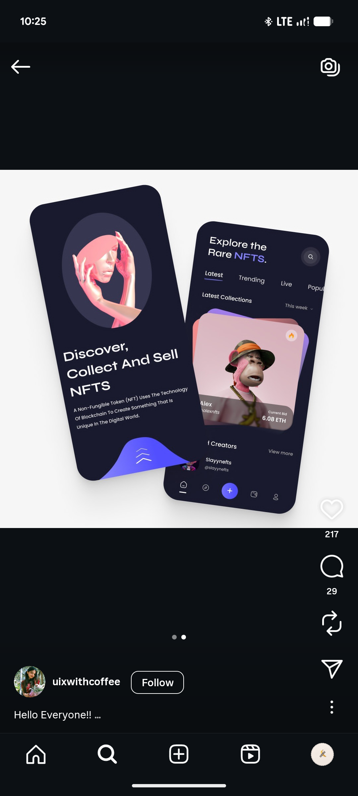

# Navy NFT Marketplace Tilted Phones

**Discipline:** app ·  · **Design style:** 3D & Surreal
**Tags:** nft, navy, tilted, lavender, 3d, onboarding, cards

## What it is
Two tilted navy phones on white: an onboarding with a pink sculptural portrait in an oval and the headline 'Discover, Collect And Sell NFTS' over a lavender wave, and an Explore the Rare NFTs screen with tabs and a stacked card holding a monkey avatar with a bid price.

## What it means
Dark screens with a pink 3D figure and lavender highlights feel premium and artful, and tilting adds motion.

## Techniques
- Phones rotated in opposite directions
- Pink sculpture in an oval as the onboarding hero
- Stacked offset cards behind the featured NFT
- Lavender used for highlighted words and the wave
- Frosted price chip over the artwork

## Best for
- NFT and collectibles app presentations
- Dark UI with a single soft accent
- Tilted two-phone compositions

## Vocabulary
- **Stacked card** — Offset layers peeking behind the main card.
- **Oval mask** — A photo cropped into an ellipse.
- **Bid chip** — A small label showing the current price.
