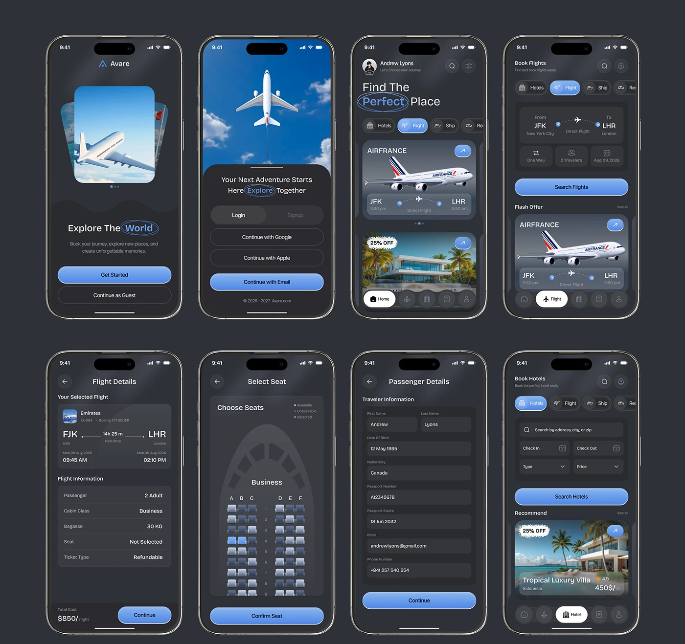

# Dark Travel Booking Screen Sheet

**Discipline:** app · **Design type:** Travel app screens
**Tags:** dark, travel, booking, blue, flights, hotels, forms, phones

## What it is
Eight phone screens on a charcoal board covering a booking flow: splash, sign-in, home, flight search, flight details, seat map, passenger form and hotel search, in dark grey UI with periwinkle-blue primary buttons.

## What it means
Dark cards and one soft blue create calm, premium travel. Showing the whole flow proves consistency.

## Techniques
- Circled word in headlines as a hand-drawn accent
- Gradient blue pill buttons on charcoal
- Photographic sky and plane imagery for hero cards
- Pill tab switcher (Hotels, Flight, Ship)
- Uniform grid of screens with identical bezels

## Best for
- Travel and booking apps
- End-to-end flow presentations
- Dark-mode UI portfolios

## Vocabulary
- **Screen sheet** — Many app screens laid out on a single board.
- **Segmented tabs** — Pill buttons that switch a section's content.
- **Seat map** — A diagram of selectable seats in a vehicle.
