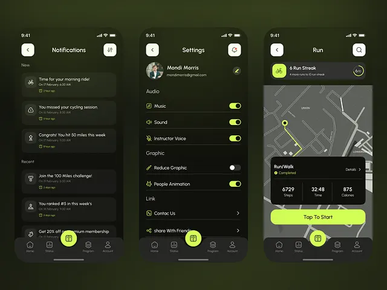

# Cycling app on dark olive with lime toggles, route line and tap-to-start bar

**Discipline:** app · **Design type:** Fitness app screens
**Tags:** fitness, running, dark-olive, lime, toggles, map, notifications, settings

## What it is
Three dark phone screens with a green-black gradient: a notification list with lime icons, a settings page with lime toggles, and a run screen with a dark map, a lime route, a stats card and a big lime Tap To Start bar. A lime circular button sits in the centre of the tab bar.

## What it means
Energetic and focused; lime on olive-black feels like night training.

## Techniques
- Use one lime accent for toggles, route and primary buttons.
- Keep panels as slightly lighter dark cards.
- Show a lime route line on a desaturated map.
- Centre a circular lime button in the nav.

## Best for
- Sports and fitness apps
- Dark-mode utility screens
- Neon-accent app systems

## Vocabulary
- **Lime toggle** — A switch coloured lime when on.
- **Centre nav button** — A prominent round button in the middle of a tab bar.
- **Route line** — A highlighted path on a map.
- **Dark card** — A slightly lighter panel on a dark background.
