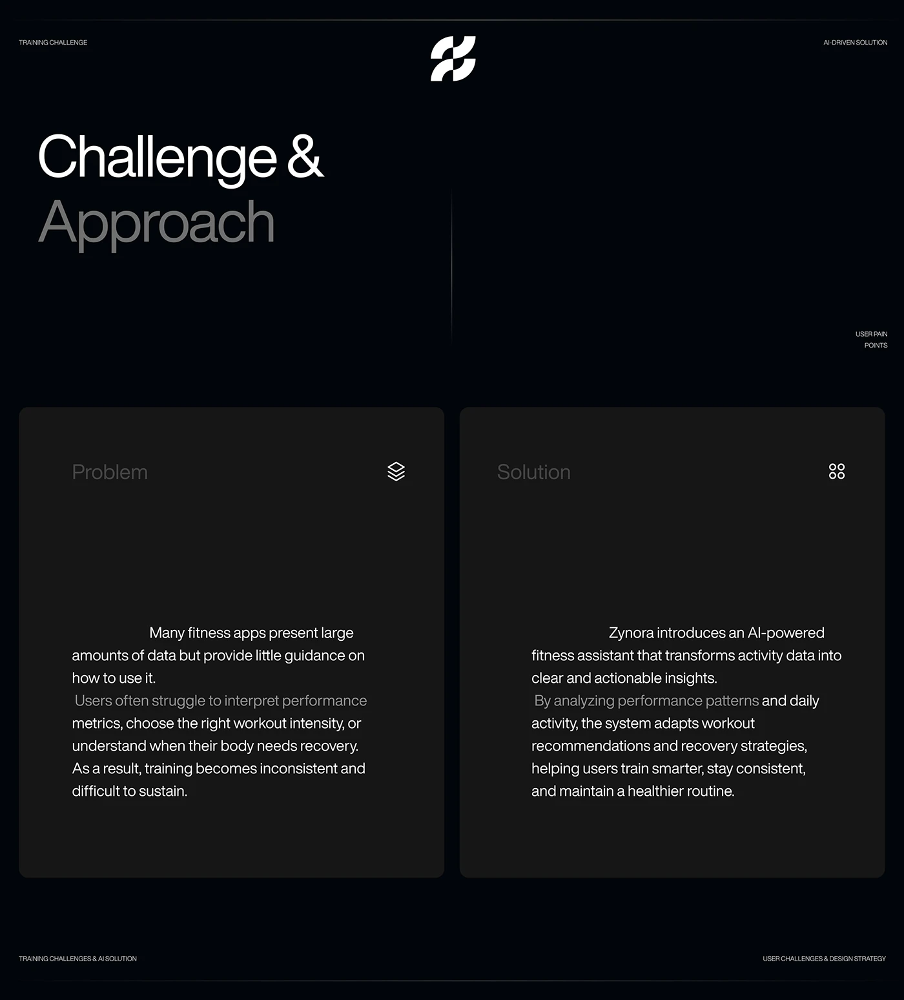

# Black challenge and approach slide with two dark grey cards and dimmed text

**Discipline:** app · **Design type:** Case study slide
**Tags:** case-study, problem-solution, black, dark-cards, dimmed-text, minimal, two-tone-type

## What it is
A black slide with a small bracket-like logo at the top, tiny corner labels, a large two-tone headline 'Challenge & Approach', and two rounded dark grey cards labelled Problem and Solution with icons and paragraphs where some sentences are dimmed.

## What it means
Serious and structured; the dimmed lines build hierarchy without colour.

## Techniques
- Split a slide into two matched dark cards for problem and solution.
- Dim secondary sentences to grey inside a paragraph.
- Use huge white then grey headline text.
- Place labels and icons in the card top corners.

## Best for
- Case-study challenge and solution slides
- Dark, monochrome presentations
- Explaining before and after

## Vocabulary
- **Two-tone headline** — A heading where the second line is dimmed.
- **Problem/solution pair** — Two cards contrasting an issue with its answer.
- **Dimmed sentence** — Grey text inside white text to show lower priority.
- **Corner labels** — Tiny caps text in corners as framing.
