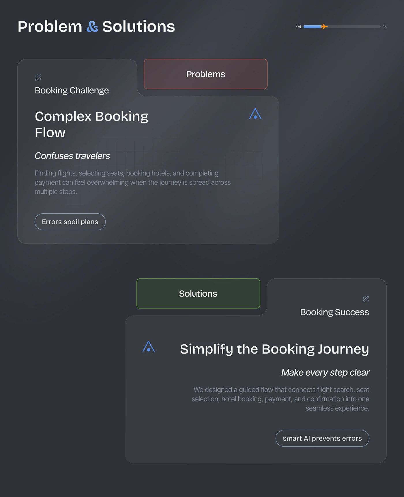

# Dark Problems and Solutions Tab Cards

**Discipline:** app · **Design type:** Process slide
**Tags:** problem-solution, dark, glass, tabs, progress-bar, plane, booking

## What it is
A dark slate slide titled Problem & Solutions with a plane-marked progress bar and two frosted cards with folder-style tabs, a red-tinted Problems tab card about a complex booking flow and a green-tinted Solutions tab card about simplifying the journey, each with an italic subhead and a pill tag.

## What it means
Red and green tabs colour-code the pair, and the folder shape makes each card feel like a file.

## Techniques
- Folder tab labels tinted red and green
- Frosted dark cards with subtle borders
- Italic subhead beneath a heavy title
- Outlined pill summarising the point
- Cards staggered left and right

## Best for
- Problem and solution slides
- Dark case-study documentation
- Colour-coded comparison

## Vocabulary
- **Folder tab** — A raised tab on a card's top edge that labels it.
- **Colour coding** — Using colour to mark meaning like problem or solution.
- **Frosted card** — A translucent blurred card on a dark background.
