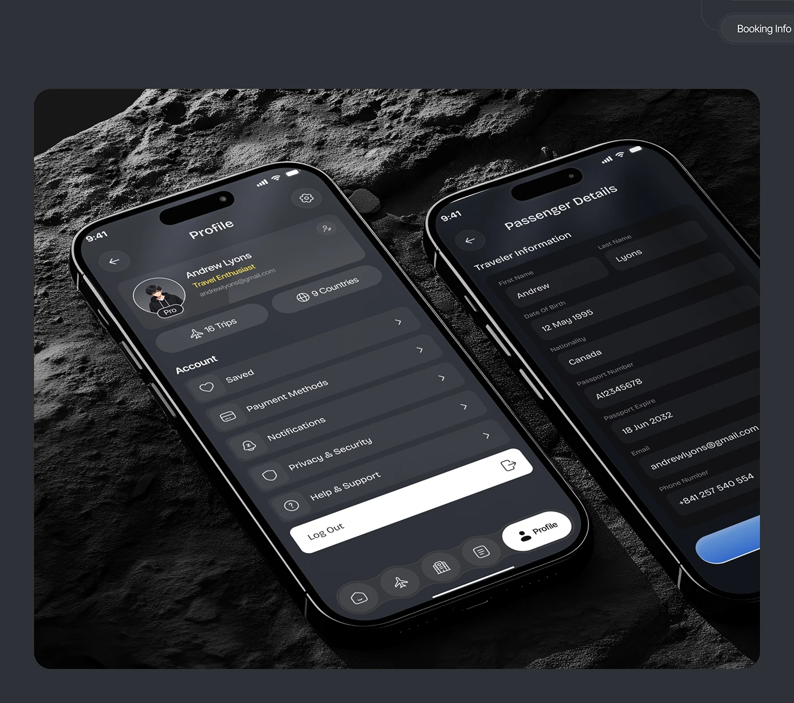

# Dark Profile and Passenger Phones on Moon Rock

**Discipline:** app ·  · **Design style:** 3D & Surreal
**Tags:** dark, profile, form, rock, tilted, travel, perspective

## What it is
A dark slate slide with a rounded photo of two phones lying tilted on cratered grey rock, showing a dark Profile screen with account rows and a white Log Out bar and a Passenger Details form, with a Booking Info pill at the top corner.

## What it means
The lunar surface and steep tilt make a dark UI feel exploratory and cinematic.

## Techniques
- Phones lying at an angle on textured rock
- Dark UI with one white bar for the key action
- Rounded photo panel on dark slate
- Perspective distortion of text along the tilt
- Pill label at the corner

## Best for
- Dark app case-study slides
- Travel app profile screens
- Textured rock mockups

## Vocabulary
- **Textured backdrop** — A rough surface used as a staging ground.
- **Perspective text** — Interface text skewed by a tilted device.
- **Key action bar** — A white bar marking the main or final action.
