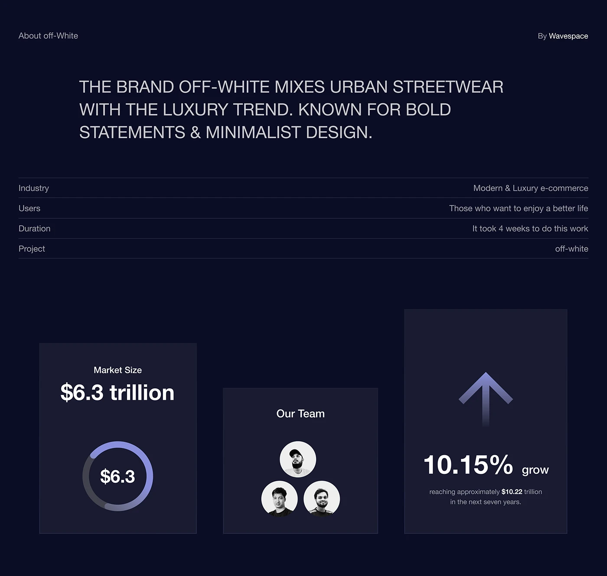

# Dark case-study facts table with market stat tiles

**Discipline:** app · **Design type:** Research insight slide
**Tags:** case-study, dark-mode, navy, project-details, stats, donut, team

## What it is
A midnight-navy slide with an uppercase paragraph, a hairline table (industry, users, duration, project) and three dark cards showing market size with a donut ring, team avatars, and a growth arrow with percentage.

## What it means
Analytical and premium; the deep navy and lavender accents feel investor-ready.

## Techniques
- Use hairline rules to build a spec table without boxes.
- Set the abstract in large light uppercase.
- Create stat cards with one graphic each (ring, avatars, arrow).
- Keep contrast low with grey-blue text on navy and a single lavender accent.

## Best for
- Case-study intro slides
- Pitch decks
- Dashboards for investors

## Vocabulary
- **Spec table** — A list of label-value pairs separated by hairlines.
- **Donut ring** — A circular progress chart with a centre value.
- **Avatar cluster** — A group of round portraits.
- **Low-contrast text** — Grey text on dark for secondary info.
