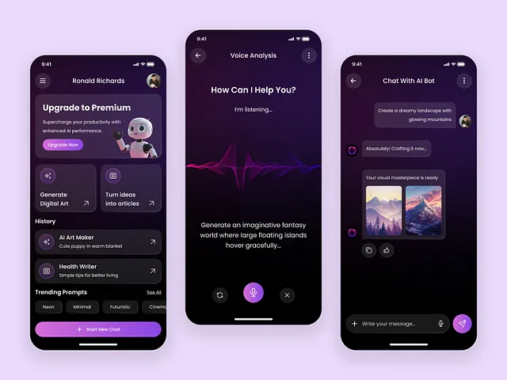

# AI assistant screens in black-violet with a pink-purple waveform and generated images

**Discipline:** app ·  · **Design style:** Gradient & Aurora
**Tags:** ai, chat, dark, violet, waveform, voice, cards, image-generation

## What it is
Three dark phone screens on lavender: a home with a mascot robot upgrade card, action tiles and history list; a voice screen with a glowing magenta-violet waveform and prompt text; and a chat showing a request and two generated mountain images with copy and like icons.

## What it means
Futuristic and friendly; the waveform makes voice tangible and the violet glow feels creative.

## Techniques
- Render voice as a glowing multi-colour waveform.
- Use a gradient pill button as the main action.
- Show generated results in bordered chat bubbles.
- Add trending prompt chips.

## Best for
- Generative-AI and chatbot apps
- Voice-driven interfaces
- Dark-mode creative tools

## Vocabulary
- **Waveform visual** — A graphic of a sound wave.
- **Result bubble** — A chat bubble containing generated media.
- **Prompt chip** — A suggested prompt shown as a pill.
- **Gradient pill** — A capsule button filled with a gradient.
