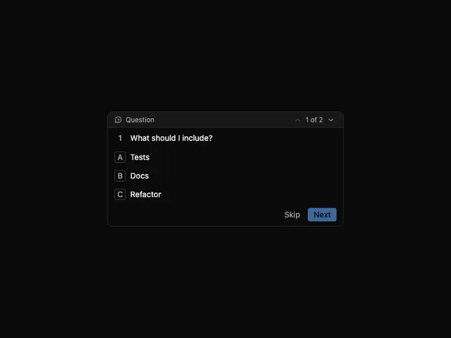

# Compact dark question panel '1 of 2' with a header, lettered options A B C and Skip and blue Next buttons

**Discipline:** app ·  · **Design style:** Dark & Neon
**Tags:** component, question, dark, options, keycaps, blue-button, pagination, ai-assistant

## What it is
A near-black bordered panel with a small icon and 'Question' label, an up/down pager '1 of 2', a numbered question 'What should I include?', three options each with a letter in a small boxed key (Tests, Docs, Refactor) and a footer with a grey Skip and a muted blue Next.

## What it means
Precise and efficient; boxed letters suggest keyboard shortcuts for quick choice.

## Techniques
- Label options with boxed letter keys.
- Add a pager for multiple questions.
- Use a muted blue for the primary action.
- Keep the panel small and dense.

## Best for
- Command and agent UI prompts
- Multiple-choice question panels
- Dark developer tools

## Vocabulary
- **Lettered option** — A choice labelled with a boxed letter key.
- **Pager** — A control showing position such as 1 of 2.
- **Skip/Next pair** — A low and a high emphasis action.
- **Compact panel** — A small bordered container for a decision.
