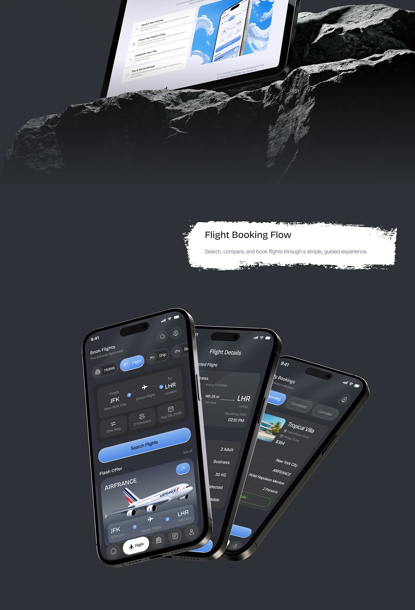

# Dark Flight Booking Phones and Rock Tablet

**Discipline:** app · **Design type:** Travel app screens
**Tags:** dark, flights, rock, tablet, brush-title, three-phones

## What it is
A slate page with a tablet resting on rock, a torn-paper 'Flight Booking Flow' banner, and three tilted dark phones showing search, flight details and bookings.

## What it means
Rock adds a rugged natural texture to a dark UI, and the fanned phones show the sequence.

## Techniques
- Real rock as a device stand
- Torn brush banner as a section title
- Fanned overlapping phones at different tilts
- Dark UI with blue gradient buttons
- Photo cards for offers

## Best for
- Dark app flow presentations
- Travel apps
- Case-study feature sections

## Vocabulary
- **Fanned phones** — Devices overlapped and rotated like a hand of cards.
- **Brush banner** — A rough paint-stroke shape behind a title.
- **Natural prop** — A rock or plant used to stage a device.
