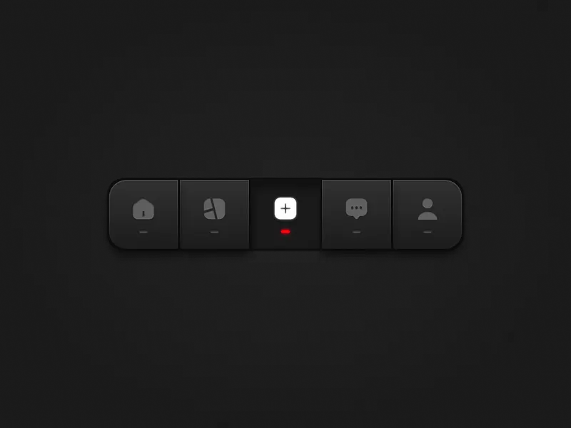

# Dark Skeuomorphic Tab Bar

**Discipline:** app · **Design type:** UI components
**Tags:** tab-bar, dark, skeuomorphic, icons, navigation, red-indicator, tactile

## What it is
A dark grey segmented navigation bar of five keys (home, chart, plus, chat, profile) with embossed icons, the centre plus lit white with a red indicator dash.

## What it means
Physical-looking keys make navigation feel tactile, and one lit key shows the active state clearly.

## Techniques
- Segmented keys with inner shadows
- Embossed grey icons on dark keys
- Active key lit white with a red dash
- Small dashes under each icon
- Dark on dark for a hardware feel

## Best for
- Tactile nav bars
- Dark UI component showcases
- Hardware-inspired interfaces

## Vocabulary
- **Skeuomorphic** — Design imitating real-world physical materials.
- **Active key** — The highlighted item in a segmented control.
- **Emboss** — A raised look given to icons or shapes.
