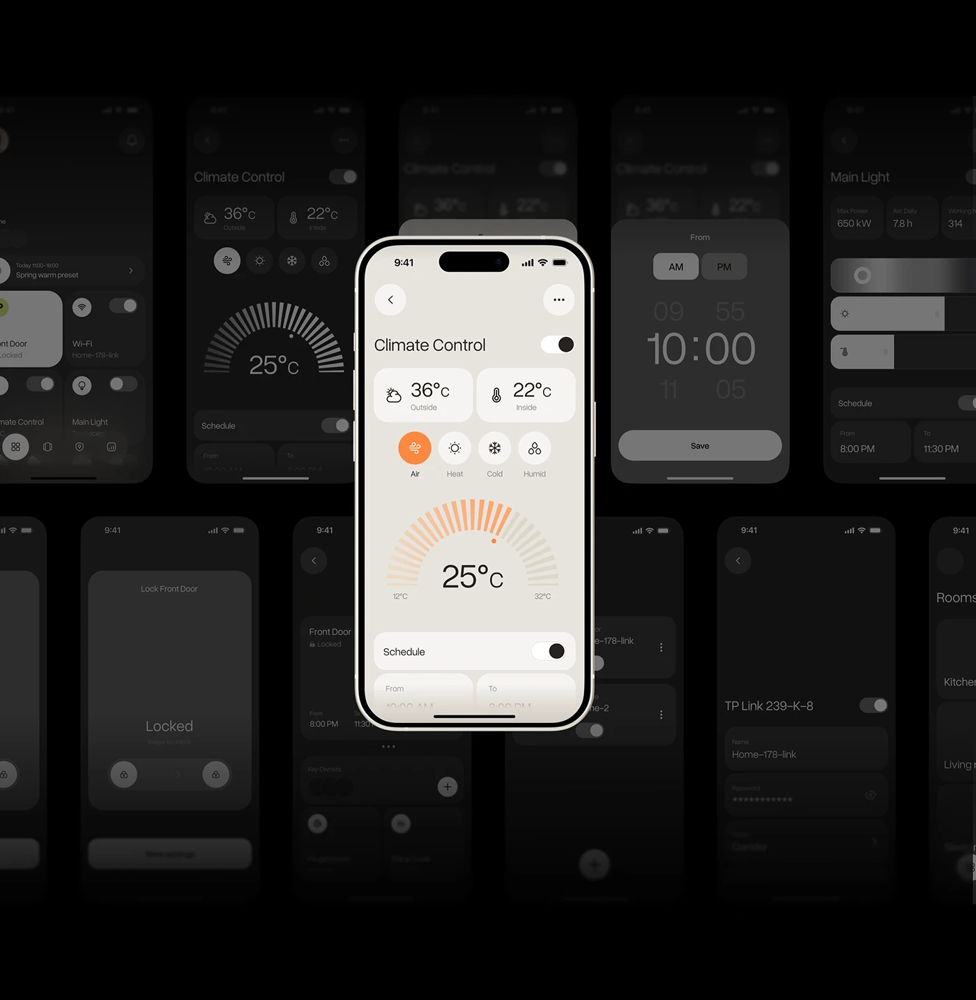

# Dark Smart-Home Screens with a Lit Hero

**Discipline:** app ·  · **Design style:** Warm & Organic
**Tags:** smart-home, dark, collage, cream, orange, gauge, climate

## What it is
A black field filled with dim phone screens of many app states (climate, lock, schedule, main light, rooms) with one bright cream phone at the centre showing a climate control with an orange segmented gauge.

## What it means
Dimming the rest lets the hero screen glow, while the ghosted screens prove the depth of the app.

## Techniques
- Many screens dimmed to near black as texture
- One fully lit hero phone in the centre
- Orange segmented arc as the signature graphic
- Screens cropped at the edges
- Cream UI against black

## Best for
- App overview presentations
- Dark showcase boards
- Showing breadth with one focus

## Vocabulary
- **Dimmed backdrop** — Secondary content faded to let a hero stand out.
- **Segmented gauge** — An arc made of radial dashes.
- **Hero screen** — The one screen shown in full brightness.
