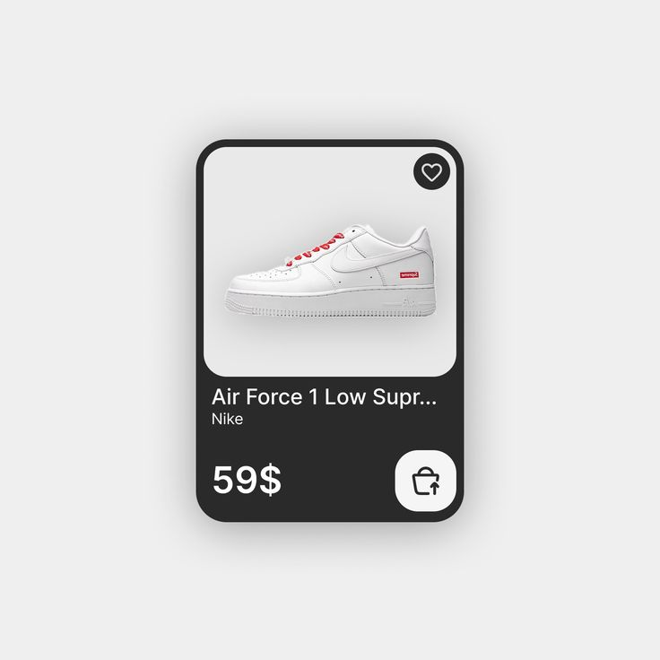

# Dark Sneaker Product Card

**Discipline:** app ·  · **Design style:** Minimalist
**Tags:** product-card, dark, sneaker, minimal, favorite, cart, rounded

## What it is
A charcoal card with a pale rounded image panel holding a white sneaker, a heart button, name and brand in white, a large price and a white rounded cart button.

## What it means
A dark card holding a bright product panel makes the product the hero and keeps the interaction points obvious.

## Techniques
- Light inset image on a dark card for strong contrast
- Circular favourite button on the image corner
- Large price paired with a big square action button
- Truncated title with ellipsis to keep a fixed height
- Soft shadow lifting the card off pale grey

## Best for
- Retail and sneaker apps
- Product listing components
- Minimal e-commerce UI

## Vocabulary
- **Inset image panel** — A picture placed in a rounded box within a card.
- **Action tile** — A square button holding a single icon.
- **Truncation** — Cutting off long text with an ellipsis.
