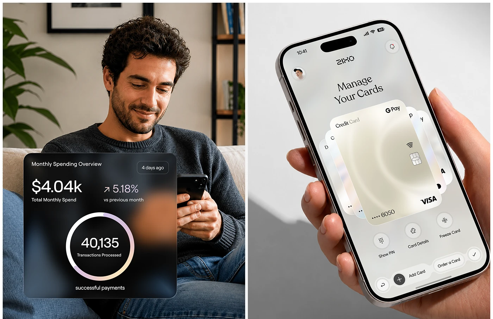

# Spending Overview Card and Card Fan Screen

**Discipline:** app · **Design type:** Fintech app screens
**Tags:** fintech, glass-card, photo, ring-chart, card-fan, pearl, split

## What it is
A split image: at left a man on a sofa with a dark frosted card overlay showing monthly spend and a ring chart of transactions; at right a hand-held phone showing 'Manage Your Cards' with a fan of pearlescent cards and action icons.

## What it means
Pairing a human moment with UI cards ties numbers to life, and the pearl card fan feels premium.

## Techniques
- Dark frosted card overlaid on a lifestyle photo
- Ring chart with a pearl gradient stroke
- Fan of cards as the hero of the screen
- Serif heading in the UI
- Two equal panels side by side

## Best for
- Fintech feature marketing
- Card management app screens
- Photo plus UI diptychs

## Vocabulary
- **Diptych** — Two related images shown side by side.
- **Ring chart** — A circular chart showing a value in a ring.
- **Card fan** — Cards overlapped in an arc.
