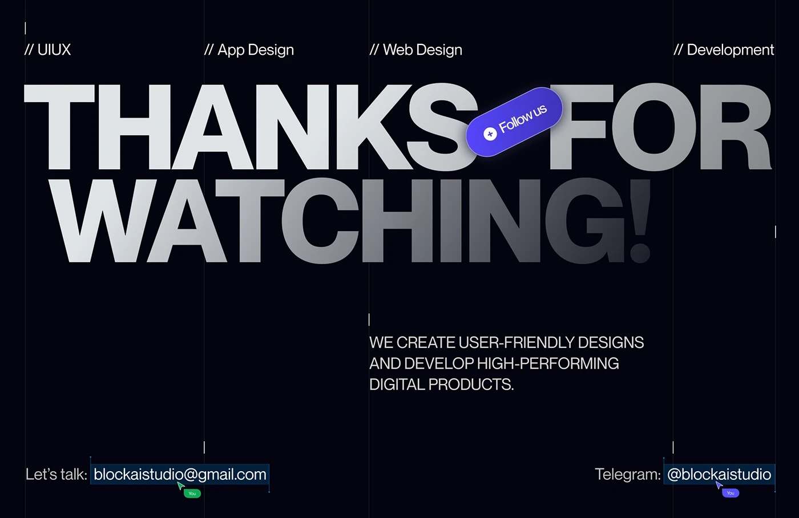

# Huge Thanks Caps with Follow Pill and Live Cursors

**Discipline:** app ·  · **Design style:** Gradient & Aurora
**Tags:** thanks, dark, huge-type, gradient, follow, cursors, contact

## What it is
A near-black slide with column guides, service labels across the top, giant silver-to-dark caps 'THANKS FOR WATCHING!' crossed by a tilted indigo Follow us pill, a caption in caps and contact lines shown as selected text with collaborator cursors.

## What it means
Live cursors and selection boxes make the closing feel like a working Figma file, and the fading caps add depth.

## Techniques
- Giant gradient caps fading to dark
- Tilted indigo pill overlapping the type
- Contact text shown selected with cursor tags
- Slash-prefixed service labels
- Thin column guides across the frame

## Best for
- Portfolio sign-offs
- Design studio closing slides
- Contact calls to action

## Vocabulary
- **Cursor tag** — A small labelled pointer imitating a collaborator in a design tool.
- **Selection box** — A blue outline around text as if selected.
- **Gradient caps** — Uppercase type fading in tone across its width.
