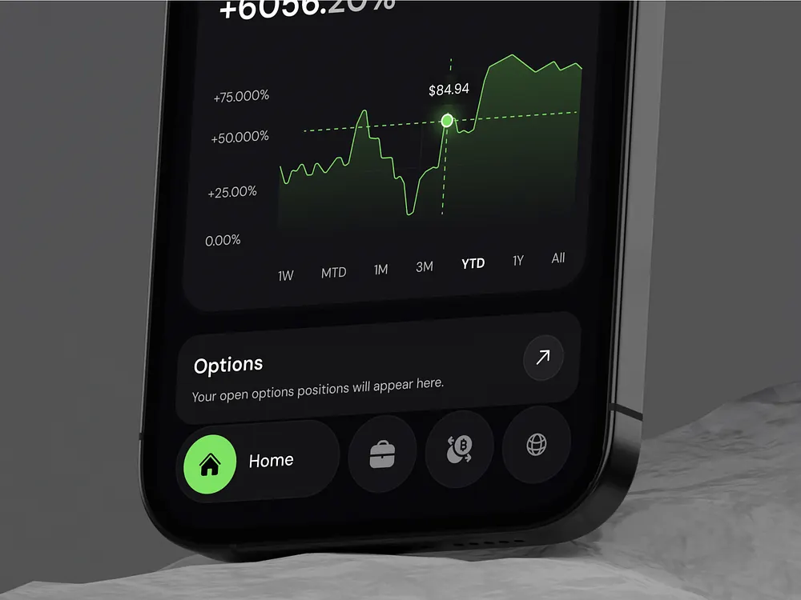

# Dark Trading Chart with Lime Home Pill

**Discipline:** app ·  · **Design style:** 3D & Surreal
**Tags:** trading, dark, green, chart, crop, stone, pill-nav

## What it is
A tight crop of a dark phone leaning on pale stone showing a green area chart with a dashed crosshair and price tooltip, time range labels (1W to All), an Options card and a nav where the active Home item is a lime circle with a label beside dark circular icons.

## What it means
The tight crop and green glow line make the chart the star, and the expanded lime pill shows the active tab clearly.

## Techniques
- Tight crop on the lower half of the device
- Green glowing line with a dashed crosshair
- Time range tabs with the selected bold
- Nav items as circles with one expanded pill
- Pale stone beneath the dark phone

## Best for
- Trading and investment app hero crops
- Dark UI with a green accent
- Chart-focused mockups

## Vocabulary
- **Crosshair** — Dashed lines marking a selected point on a chart.
- **Range tabs** — Labels for choosing a time span such as 1W or 1Y.
- **Expanded pill** — An active nav item that widens to show its label.
