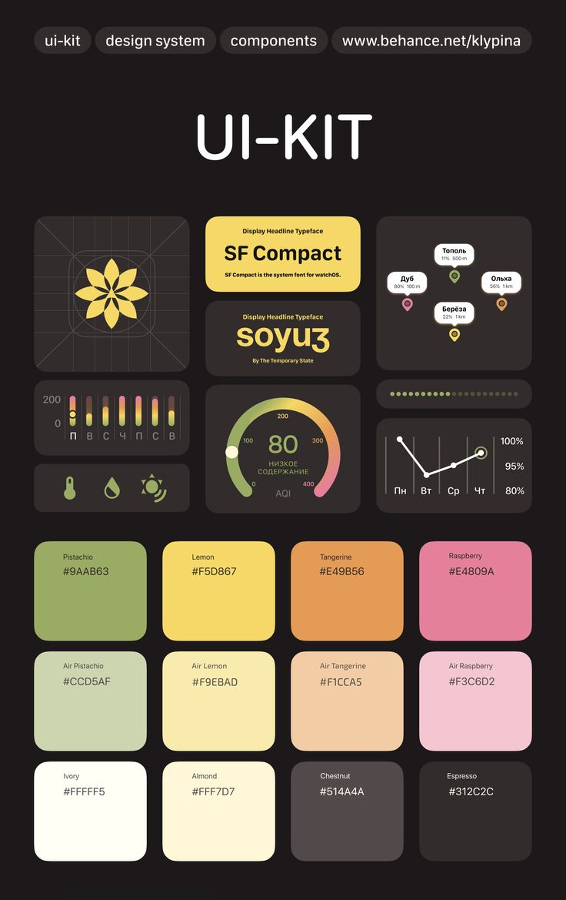

# Dark Watch UI Kit with Fruit Palette

**Discipline:** app · **Design type:** Design system documentation
**Tags:** ui-kit, dark, yellow, palette, gauge, watch, fruit-names, tokens

## What it is
A black UI-kit poster with pill labels at the top, a giant 'UI-KIT' title, bento tiles of a yellow petal icon on a grid, font specimens in yellow, chart widgets (a gradient bar chart, an AQI gauge, a line chart, map pins) and a 4-by-3 grid of named colour swatches (Pistachio, Lemon, Tangerine, Raspberry and their pale Air versions, Ivory, Almond, Chestnut, Espresso).

## What it means
Food-themed colour names and a warm palette on black make a technical kit feel appetising, and gradient gauges show the palette in use.

## Techniques
- Named swatches with hex codes in a tidy grid
- Pale and saturated pairs of each hue
- Yellow accent tiles on dark neutrals
- Gradient gauges using the palette
- Icon shown on a construction grid

## Best for
- UI-kit and design-system posters
- Wearable and data widget systems
- Named colour palettes

## Vocabulary
- **Named swatch** — A colour sample labelled with a memorable name and hex code.
- **Tint pair** — A saturated colour paired with a paler version.
- **Widget tile** — A small dark card holding one data visual.
