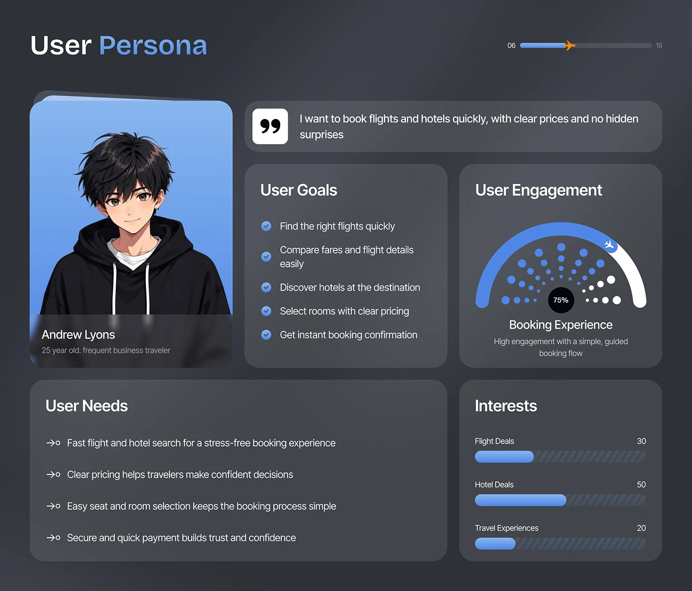

# Dark User Persona Board

**Discipline:** app · **Design type:** Research insight slide
**Tags:** persona, dark, cards, goals, needs, engagement, blue

## What it is
A dark slate slide titled User Persona with a portrait card of an anime-style traveller, a quote bar, cards for goals with blue checks, a semicircle engagement gauge with dots, needs arrows, and striped interest bars.

## What it means
Modular dark cards break a persona into scannable parts, and blue accents tie it to the product.

## Techniques
- Persona portrait card with name overlay
- Big quote mark tile leading a quote bar
- Checklist with blue check circles
- Dotted gauge for an engagement metric
- Hatched bar tracks for interests

## Best for
- UX persona slides
- Dark-mode research presentations
- Product case studies

## Vocabulary
- **Persona card** — A fictional user profile summarising goals and needs.
- **Dotted gauge** — An arc gauge made of dots with one highlighted value.
- **Hatched track** — A bar background striped with diagonal lines.
