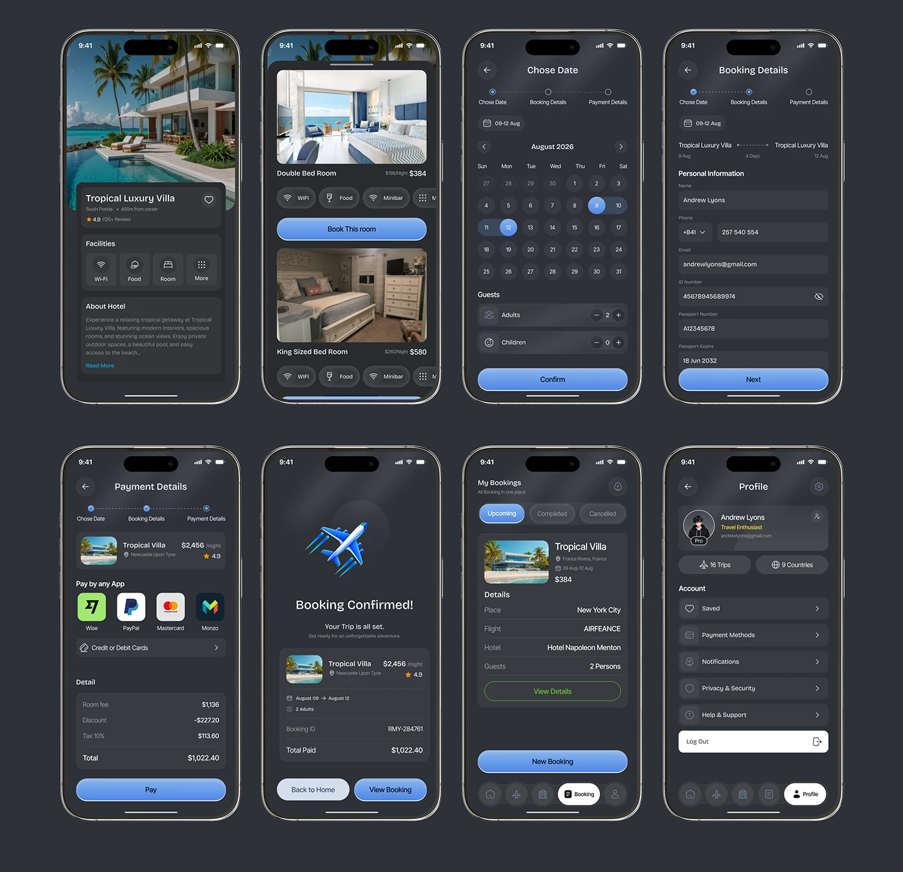

# Villa Booking Flow Screen Sheet

**Discipline:** app · **Design type:** Travel app screens
**Tags:** dark, booking, hotel, calendar, payment, profile, blue, phones

## What it is
Eight dark phone screens: villa detail, room choices, date picker, personal information, payment, booking confirmation, bookings list and profile, with periwinkle-blue gradient buttons and step trackers.

## What it means
A consistent dark card system with one accent makes a long flow feel cohesive and premium.

## Techniques
- Three-step progress tracker at the top of the flow
- Big photo header on the detail screen with an overlaid info card
- Range selection highlighted in blue on a calendar
- Payment method icons in rounded tiles
- Confirmation screen with a 3D icon as a reward moment

## Best for
- Booking and travel apps
- Full-flow UI presentations
- Dark-mode design systems

## Vocabulary
- **Step tracker** — A row of dots and labels showing progress through a flow.
- **Reward moment** — A celebratory visual at the end of a task.
- **Range picker** — A calendar selecting start and end dates.
