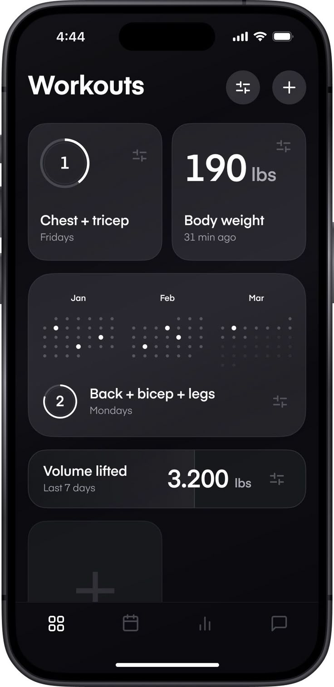

# Dark Workouts Dashboard with Dot Calendar

**Discipline:** app · **Design type:** Health app screens
**Tags:** workouts, dark, cards, dot-calendar, ring, minimal, monochrome

## What it is
A full-frame dark phone screen titled Workouts with a filter and plus button, cards showing a ring counter for Chest + tricep, a large 190 lbs body weight, a dot-grid calendar over three months with white dots for sessions, a Back + bicep + legs plan, a Volume lifted stat and an empty add tile, above a four-icon tab bar.

## What it means
Dot calendars and ring counters give a monochrome interface personality without colour, and large numerals carry the data.

## Techniques
- Dot-grid calendar with white dots for activity
- Ring counters holding a number
- Large numerals for key measures
- Monochrome dark cards with subtle borders
- Empty dashed add tile at the base

## Best for
- Workout and fitness trackers
- Monochrome dark UI
- Dot-matrix calendar graphics

## Vocabulary
- **Dot calendar** — A calendar drawn as a grid of small dots.
- **Ring counter** — A number inside a partly filled ring.
- **Add tile** — An empty card inviting the user to add content.
