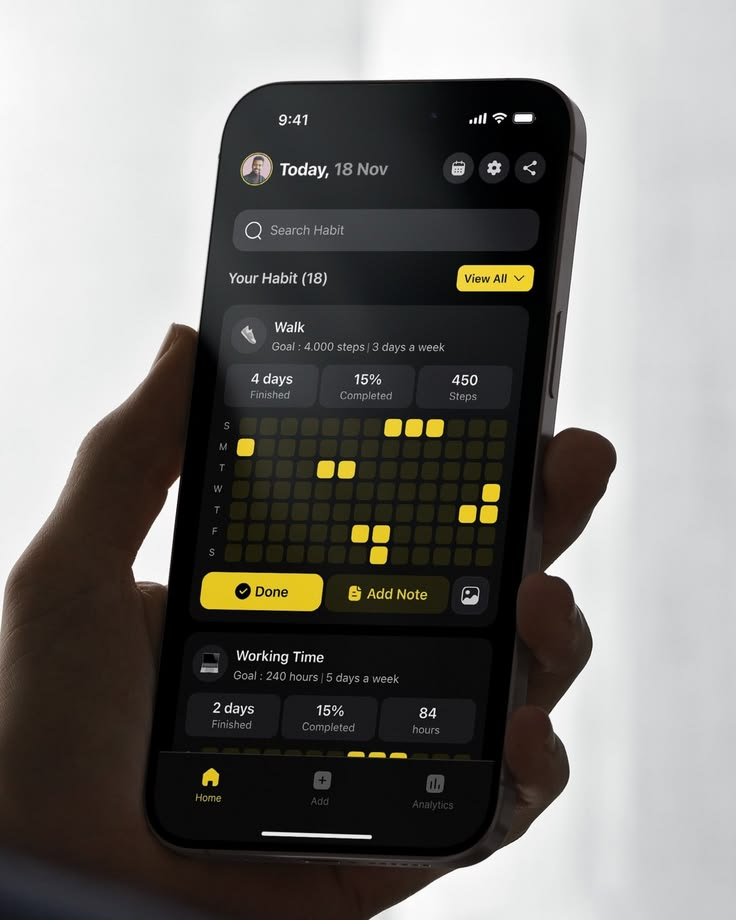

# Dark Habit Tracker with Yellow Heatmap

**Discipline:** app ·  · **Design style:** Dark & Neon
**Tags:** habit, dark, yellow, heatmap, grid, hand, silhouette

## What it is
A hand holding a dark phone in front of a bright window, showing a habit tracker with a search bar, habit cards with stat trios and a grid of dim cells where completed days glow yellow, plus yellow Done and View All buttons and a tab bar.

## What it means
Yellow cells on dark grid make progress feel like a glowing pattern, and the silhouetted hand adds a cinematic feel.

## Techniques
- Heatmap grid of small squares with yellow for done
- Single yellow accent on black UI
- Stat trio above each grid
- Backlit silhouette hand
- Bright window backdrop for contrast

## Best for
- Habit and productivity trackers
- Dark UI with one accent
- Calendar heatmap visuals

## Vocabulary
- **Habit heatmap** — A grid of days where filled cells show completions.
- **Stat trio** — Three key numbers in a row.
- **Backlit hand** — A hand silhouetted against a bright background.
