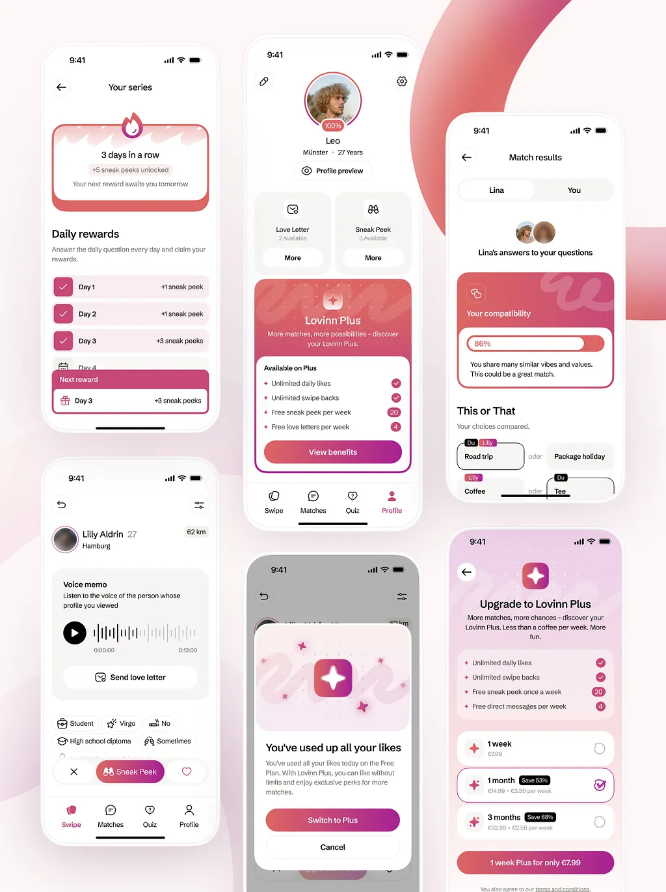

# Six dating app screens in raspberry gradients: streaks, premium plans, match compatibility and voice memo

**Discipline:** app ·  · **Design style:** Gradient & Aurora
**Tags:** dating, pink, raspberry, gradient, subscriptions, checkmarks, compatibility, white-ui

## What it is
Six phones on white with soft berry swooshes. Screens include a flame streak card with daily reward rows, a profile with premium cards, a match result with a compatibility bar and 'this or that' answers, a voice memo profile, a like-limit modal and a plan picker with selectable pricing rows.

## What it means
Warm and playful; berry gradients on white feel romantic without clutter.

## Techniques
- Use one berry gradient for premium elements.
- Show rewards as check rows for a streak.
- Present pricing as selectable rows with save badges.
- Add a waveform for voice memos.

## Best for
- Dating and social apps
- Subscription and paywall screens
- Gamified reward streaks

## Vocabulary
- **Streak card** — A card showing consecutive days.
- **Compatibility bar** — A bar showing percent match.
- **Plan row** — A selectable pricing option.
- **Premium gradient** — A special gradient marking paid features.
