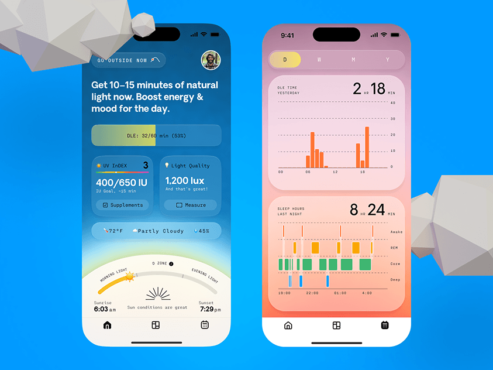

# Daylight and sleep tracker screens with glass cards and low-poly clouds

**Discipline:** app · **Design type:** Health dashboard
**Tags:** health, sun, sleep, glass, gradient, bar-chart, monospace, low-poly

## What it is
Two phone screens on cobalt. The left is a sky gradient with a progress bar, small info tiles and a sunrise arc; the right is a pink-peach gradient with glass cards containing bar and stage charts for daylight and sleep. Low-poly grey clouds float at the edges.

## What it means
Optimistic and natural: the background gradient itself expresses time of day.

## Techniques
- Make the whole screen gradient match the subject (sky vs sunset).
- Use frosted cards holding data over the gradient for legibility and depth.
- Pair monospace labels with big numbers for a precise, scientific accent.
- Add 3D low-poly props outside the phones to bridge the UI and the poster.

## Best for
- Sleep, light and circadian apps
- Environmental or weather-based UIs
- Showcase shots for health products

## Vocabulary
- **Contextual gradient** — A background that changes to reflect time or state.
- **Stage chart** — A chart showing categories (sleep stages) over time.
- **Low-poly** — 3D shapes built from few flat facets.
- **Sunrise arc** — A curved timeline showing the sun's path.
