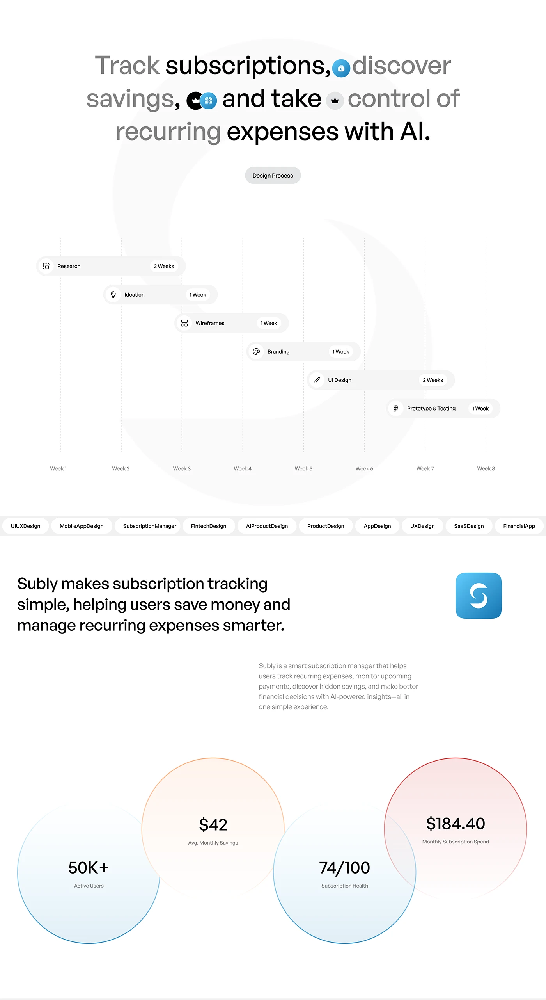

# Design Process Gantt with Inline Icon Headline

**Discipline:** app ·  · **Design style:** Playful & Illustrated
**Tags:** gantt, process, white, inline-icons, circles, stats, hashtags

## What it is
A tall white page with a headline whose words alternate grey and black with small app icons inline, a Design Process pill, a Gantt chart of six capsules stepping down across eight weeks, a strip of hashtag pills, a statement with an app icon and four overlapping outlined circles with tinted fills holding stats (50K+ users, $42 savings, 74/100, $184.40).

## What it means
Overlapping tinted circles make numbers feel like bubbles, and the inline icons make a headline part illustration.

## Techniques
- Inline app icons inside a headline
- Capsule Gantt with week labels
- Overlapping outlined circles filled with soft gradients
- Hashtag strip as a marquee
- Huge faint logo shape behind the chart

## Best for
- Design process and stats slides
- Subscription and fintech case studies
- Long-scroll case study pages

## Vocabulary
- **Overlap bubbles** — Circles overlapping with transparent tints.
- **Hashtag strip** — A row of pills listing tags.
- **Inline icon** — An icon set within a line of text.
