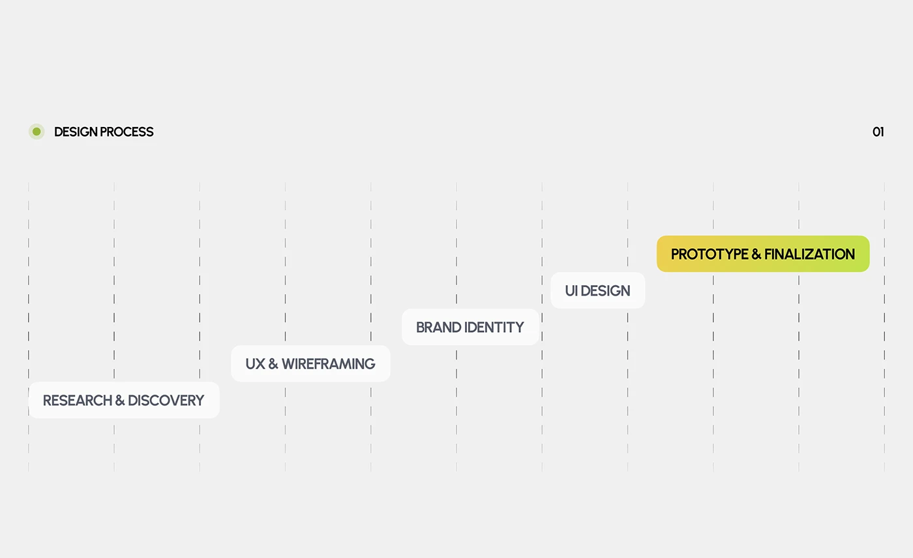

# Five design-process pills rising in steps on dashed columns with a yellow-green gradient final step

**Discipline:** app · **Design type:** Process slide
**Tags:** process, staircase, light-grey, dashed-lines, gradient-pill, minimal, lime, case-study

## What it is
A light grey slide 'Design Process 01' with dashed vertical column guides and five white rounded labels stepping up to the right (Research & Discovery, UX & Wireframing, Brand Identity, UI Design), the last 'Prototype & Finalization' filled with a yellow-to-green gradient.

## What it means
Simple and rising; the gradient step marks completion.

## Techniques
- Step labels up diagonally on dashed columns.
- Make the final step a gradient.
- Keep others white and dark grey.
- Use a small dot header.

## Best for
- Design process slides
- Timeline summaries
- Minimal light decks

## Vocabulary
- **Dashed column guide** — A dashed vertical line as a layout guide.
- **Rising labels** — Labels stepped upward across a slide.
- **Gradient final step** — The last item highlighted with a gradient.
- **Section dot** — A small green dot beside a heading.
