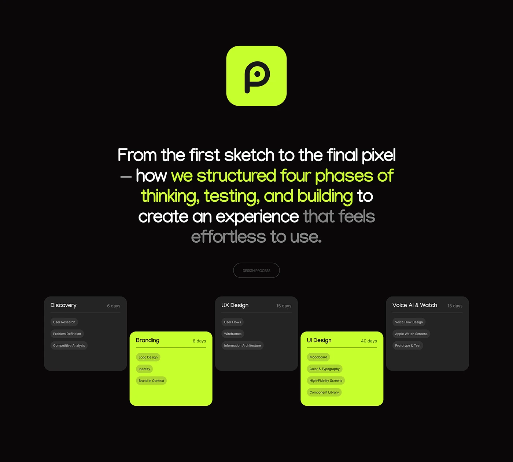

# Black slide with lime app icon, marker-style statement and staggered phase cards with days

**Discipline:** app · **Design type:** Process slide
**Tags:** process, timeline, black, lime, phase-cards, statement, pills, case-study

## What it is
A black slide with a lime rounded app icon, a large statement where a middle phrase is lime and the end is grey, an outlined 'DESIGN PROCESS' pill and five staggered cards (Discovery 6 days, Branding 8, UX Design 15, UI Design 40, Voice AI & Watch 15) listing tasks as chips; alternate cards are lime.

## What it means
Structured and energetic; the stagger and lime alternation give a rhythm to a timeline.

## Techniques
- Stagger cards up and down to make a zigzag timeline.
- Alternate dark and lime card fills.
- Show tasks as small chips inside each card.
- Colour a phrase in the statement lime and fade the end.

## Best for
- Design process and timeline slides
- Dark case studies
- Project scope overviews

## Vocabulary
- **Zigzag timeline** — Phase cards alternating in height.
- **Task chip** — A small pill listing one task.
- **Duration label** — A grey figure like '15 days' on a card.
- **Fade-out phrase** — The end of a sentence dimmed.
