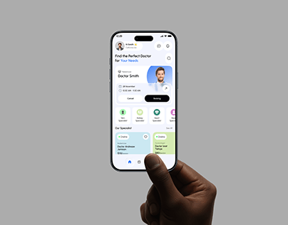

# Doctor Booking App Held Between Fingers

**Discipline:** app · **Design type:** Device mockup scene
**Tags:** healthcare, doctor, grey, hand, pastel, booking, thumbnail

## What it is
A minimal cover on flat grey with a dark hand holding a phone from below, showing a doctor-finder home with a booking card and pastel specialty cards.

## What it means
A single hand on neutral grey makes the phone look like a simple, approachable tool.

## Techniques
- Flat grey backdrop with the hand entering from the bottom
- Small phone centred with generous space
- Pastel green and blue cards for categories
- Blue accent on the title
- Black primary button for the main action

## Best for
- Healthcare and appointment apps
- Minimal cover images
- Neutral portfolio galleries

## Vocabulary
- **Flat backdrop** — A plain single-colour background.
- **Specialty card** — A card for a category of doctor or service.
- **Hand from below** — A hand entering the frame from the bottom edge.
