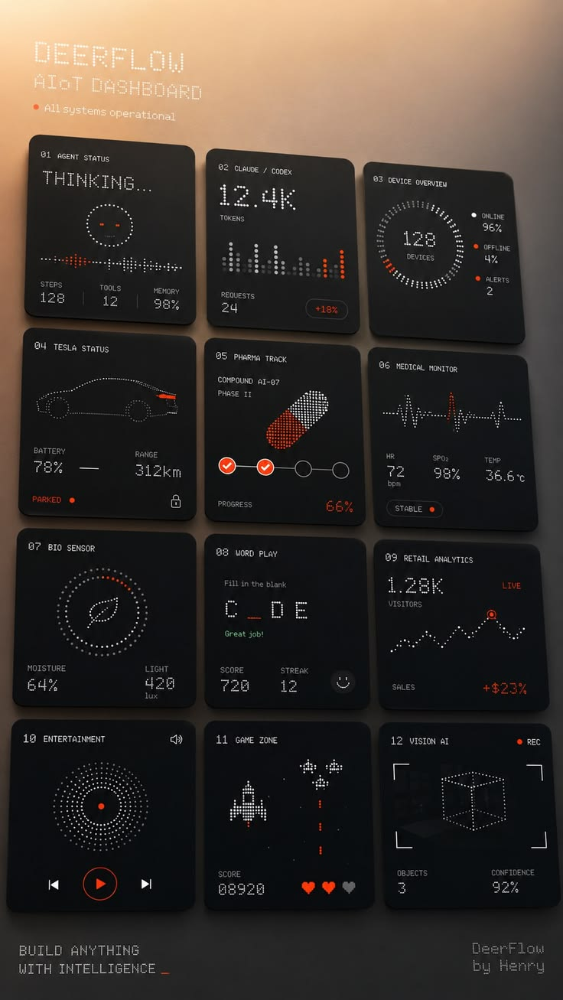

# Dot-Matrix AIoT Dashboard Tile Wall

**Discipline:** app ·  · **Design style:** Neo-Brutalist
**Tags:** dashboard, dot-matrix, orange, black, monospace, tiles, widgets, aiot

## What it is
A warm gradient poster with a dot-matrix title and a 3-by-4 grid of tilted black tiles, each a numbered widget drawn from dots and lines: agent status, tokens chart, device ring, car status, pill progress, medical monitor, bio sensor, word game, retail analytics, music, space game and vision AI.

## What it means
Everything drawn in dots with only orange-red accents feels like a retro display and makes twelve different widgets one family.

## Techniques
- Dot-matrix drawing for icons, charts and rings
- One orange-red accent on black tiles
- Numbered monospace tile labels
- Tiles slightly tilted like a wall of screens
- Warm peach-to-dark gradient backdrop

## Best for
- Dashboard widget concepts
- Retro display and LED aesthetics
- Data visualisation in a single style

## Vocabulary
- **Dot-matrix style** — Graphics built from a grid of small dots.
- **Widget wall** — Many small dashboard tiles arranged in a grid.
- **Monospace label** — Small technical text set in a fixed-width font.
