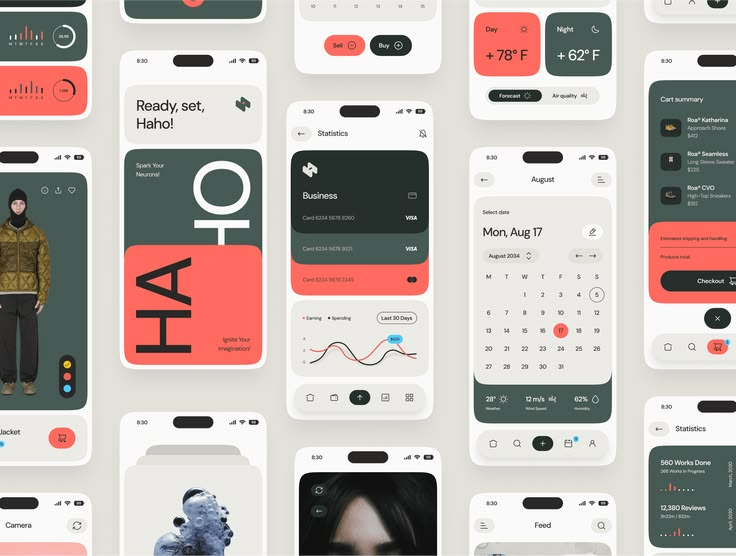

# Coral, Forest and Cream UI Screen Wall

**Discipline:** app · **Design type:** UI components
**Tags:** screen-wall, coral, forest-green, cream, cards, calendar, charts

## What it is
A pale grey wall of tiled phone screens in coral, forest green and cream: a rotated 'HAHO' title card, a business card stack with a line chart, a month calendar, weather cards, a cart summary and product and profile screens.

## What it means
A tight three-colour palette makes many different screens feel like one family, and rotated type adds a graphic jolt.

## Techniques
- Three-colour palette across all screens
- Rotated big type inside a card
- Stacked cards for a wallet
- Rounded pill navigation bars
- Tiling many phones into a dense grid

## Best for
- UI system showcases
- Palette-driven app design
- Dribbble-style screen collections

## Vocabulary
- **Screen wall** — Many app screens tiled together as a poster.
- **Rotated type** — Text turned 90 degrees inside a layout.
- **Three-colour system** — A design limited to three main hues.
