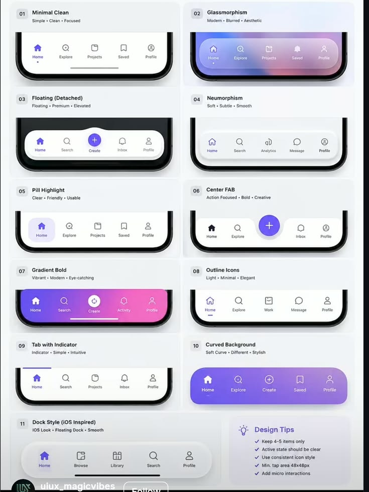

# Eleven Bottom Navigation Bar Styles

**Discipline:** app ·  · **Design style:** Glassmorphism
**Tags:** navigation, tab-bar, styles, catalog, glassmorphism, floating, gradient, tips

## What it is
A pale grid of eleven mobile bottom navigation bar styles, each in a card with a number and descriptor words: minimal, glassmorphism, floating, neumorphism, pill highlight, centre FAB, gradient bold, outline icons, tab with indicator, curved background and dock style, plus a design tips box.

## What it means
A side-by-side catalogue lets designers compare styles quickly, and the descriptors name the mood of each.

## Techniques
- Same five tabs shown in eleven styles
- Three descriptor words under each style name
- Phone bottom edge as a consistent frame
- Violet and pink as the only colours
- Tips list in a highlighted box

## Best for
- Navigation pattern catalogues
- UI education posts
- Comparing component styles

## Vocabulary
- **Floating nav** — A tab bar detached from the screen edges.
- **Centre FAB** — A raised round action button in the middle of a tab bar.
- **Dock style** — A rounded translucent bar like an operating-system dock.
