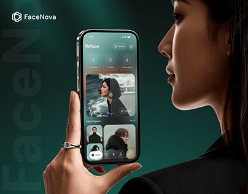

# Emerald Photo App Held Beside a Face

**Discipline:** app ·  · **Design style:** Photographic & Cinematic
**Tags:** emerald, portrait, photo-app, hand, ghost-type, dark-green, thumbnail

## What it is
A cover where a woman in profile holds a phone with a dark teal photo-editing app next to her face, on an emerald gradient with giant ghost 'FaceNova' lettering and a hex logo.

## What it means
Putting the phone beside a real face tells the product story instantly (face editing). Deep emerald feels premium.

## Techniques
- Person in profile pairing subject with product
- Ghost brand name cropped behind the figure
- Deep green gradient with a light glow behind the head
- Ring and hand detail for realism
- Logo lockup top left

## Best for
- Photo and beauty AI apps
- Portfolio cover images
- Dark premium consumer apps

## Vocabulary
- **Profile portrait** — A side view of a face used as a compositional anchor.
- **Ghost brand name** — Oversized low-contrast brand text behind the subject.
- **Product-in-context** — Showing an app next to the thing it acts on.
