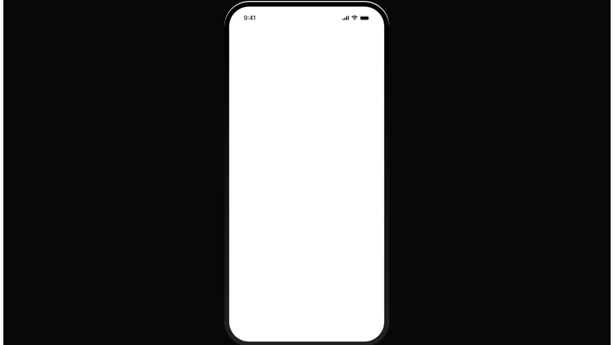

# Blank white phone screen on pure black stage

**Discipline:** app ·  · **Design style:** Minimalist
**Tags:** mockup, blank, black, minimal, phone-frame, template, white-screen

## What it is
A pure black wide frame with a single centred phone with a black bezel and an entirely white blank screen with only a status bar.

## What it means
A neutral, dramatic stage waiting for content; contrast makes the device shape clear.

## Techniques
- Show a phone as a blank canvas on black to set up a reveal or animation.
- Keep the status bar to hint at realism.
- Use the white screen as a starting frame for transitions.

## Best for
- Animated case-study intros
- Template starting frames
- Showcase reveals

## Vocabulary
- **Blank canvas frame** — An empty device used before content appears.
- **Black stage** — A pure black background for a presentation.
- **Status bar** — The top strip showing time and signal.
- **Reveal frame** — The first frame of an animated sequence.
