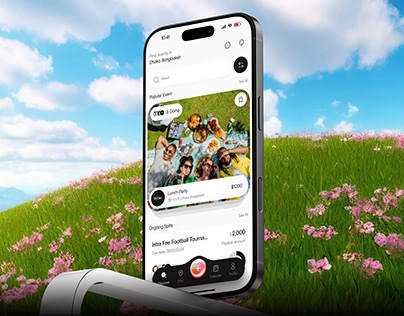

# Event App Meadow Thumbnail

**Discipline:** app · **Design type:** Device mockup scene
**Tags:** meadow, sky, events, thumbnail, phone, cover, green

## What it is
A small square cover of a white event app phone rising from a green flower meadow under a blue sky, with a chrome arc at the base.

## What it means
Big colour fields of blue sky and green grass read instantly at thumbnail size and set a cheerful tone.

## Techniques
- Three simple colour bands (sky, grass, phone) for legibility
- Phone centred and upright as a monolith
- Cloud texture for depth
- Chrome element for a subtle surprise
- No text, the picture alone sells the mood

## Best for
- Portfolio gallery thumbnails
- App campaign teasers
- Playful social apps

## Vocabulary
- **Monolith placement** — A device standing upright and centred like a monument.
- **Colour band** — A large area of a single colour that structures the image.
- **Thumbnail legibility** — How well a design reads when shrunk.
