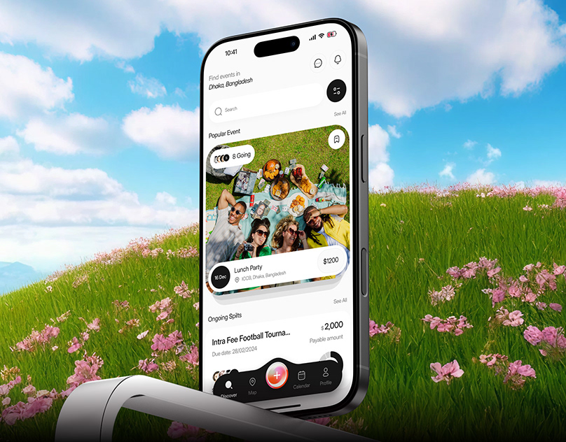

# Events and expense-splitting app floating above a flower meadow

**Discipline:** app · **Design type:** Device mockup scene
**Tags:** events, mockup, meadow, sky, white-ui, photo-card, tab-bar, surreal

## What it is
A phone stands in a bright meadow of pink flowers under a blue sky and clouds. The screen is white and shows a location search, a large photo card of friends at a picnic with a date chip and price, and a list for ongoing splits with a black floating tab bar with a red centre button.

## What it means
Fresh, sunny and social; the scene matches the app's outdoors event content.

## Techniques
- Composite the phone into a surreal landscape that matches the content.
- Use a giant photo card with overlay date and price pill.
- Float a dark pill tab bar with a bright central action.
- Keep the UI white so the scene colours surround it.

## Best for
- Event, social and group-payment apps
- Lifestyle app launches
- Mockups with a sense of place

## Vocabulary
- **Composite scene** — A mockup placed in a constructed landscape.
- **Photo event card** — A large image card with overlaid info.
- **Floating tab bar** — A detached navigation pill.
- **Centre action button** — A prominent add button in the middle of the nav.
