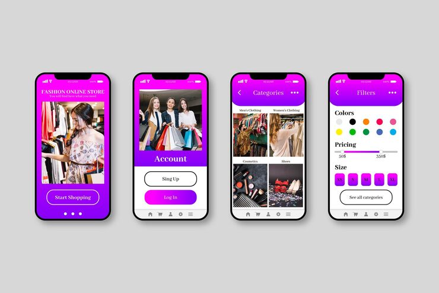

# Fashion Online Store app screens: magenta gradient onboarding, account, categories and filter panels

**Discipline:** app · **Design type:** E-commerce app · **Design style:** Gradient & Aurora
**Tags:** fashion, ecommerce, magenta, gradient, filters, onboarding

## What it is
Four phone screens with a magenta-to-purple gradient: an onboarding screen with a shopping photo and 'Start Shopping' button, an account screen with sign-up/log-in buttons, a categories grid (Men's, Women's Clothing, Cosmetics, Shoes) and a filters panel with colour swatches, a price slider and size buttons.

## What it means
Vivid and energetic; one bold gradient across every screen makes a fashion app feel youthful and distinctive.

## Techniques
- Apply one consistent gradient across every screen for brand recognition.
- Use a 2x2 photo grid for category browsing.
- Offer colour swatches directly inside the filter panel.

## Best for
- Fashion e-commerce apps
- Gradient-branded UI kits
- Category and filter UX

## Vocabulary
- **Filter panel** — A UI section for narrowing results by attributes like size or price.
- **Category grid** — A grid of images representing browsable product groups.
