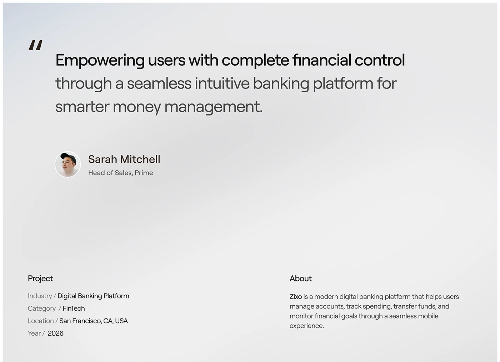

# Grey-blue quote slide with project metadata

**Discipline:** app ·  · **Design style:** Corporate & Clean-Tech
**Tags:** case-study, quote, fintech, grey, gradient, testimonial, metadata

## What it is
A pale grey slide with a soft blue gradient. A large quote mark and two-tone statement (black then grey) sits above an avatar and name; at the bottom, Project and About columns list metadata in slash-separated labels.

## What it means
Quiet, professional and elegant; the layout gives the words all the weight.

## Techniques
- Set a statement half in black, half in grey to build hierarchy in one paragraph.
- Use slash-separated label/value pairs for compact metadata.
- Place a small avatar and name beneath a quote for credibility.
- Keep background a soft misty gradient with no other decoration.

## Best for
- Case-study summaries and testimonials
- Fintech and SaaS portfolios
- Slide decks with restrained tone

## Vocabulary
- **Pull quote** — A highlighted statement or testimonial.
- **Two-tone text** — One statement in two tones for emphasis.
- **Label / value pair** — Metadata shown as grey label and dark value.
- **Mist gradient** — A very soft pale gradient background.
