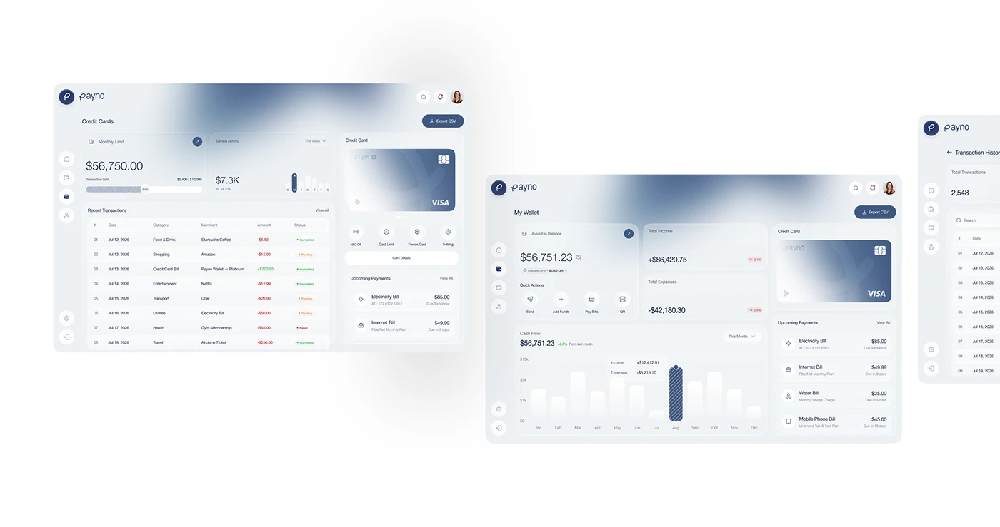

# Fintech web dashboards with blurred blue-grey glass headers

**Discipline:** app · **Design type:** Dashboard
**Tags:** dashboard, fintech, blue-grey, glass, cards, transactions, bar-chart, desktop

## What it is
Two overlapping desktop dashboards on white, each a pale blue-grey glass surface with a deep blue blurred cloud at the top. Panels hold a monthly limit progress bar, a transactions table, a large gradient credit card with quick actions, a wallet balance with cash-flow bars and upcoming payments.

## What it means
Calm and trustworthy; the blur cloud adds mood without adding noise.

## Techniques
- Place a soft blue blur cloud at the top of the window as a header background.
- Stack cards with subtle borders and shadows on a pale glass surface.
- Use one hatched bar to highlight the selected month in a chart.
- Show a large gradient credit card as a hero.

## Best for
- Banking and wallet web apps
- Dashboard presentations
- Fintech brands in blue

## Vocabulary
- **Glass surface** — A translucent pale panel with blur.
- **Hatch highlight** — A striped fill marking the active data bar.
- **Wallet card** — A large card graphic in a finance UI.
- **Overlapping windows** — Two UI screens staggered in a presentation.
